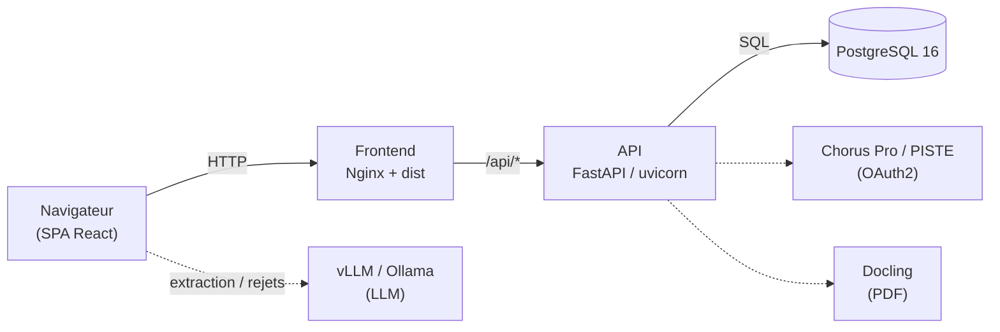

# Dossier d'Architecture Projet (DAP) — Technique

**Projet : Chorus Pilot** (hub d'automatisation de facturation — InvoicePilot)

| | |
|---|---|
| **Projet** | Chorus Pilot — préparation, contrôle, synchronisation et soumission de factures vers Chorus Pro via PISTE |
| **Dépôt** | `JADIAhmedAmine/chorus-path-finder-main` (privé) |
| **Périmètre du document** | Architecture technique du projet (toutes briques) |
| **Version du document** | 1.1 |
| **Date** | 15 juin 2026 |
| **Statut** | Diffusable (interne projet) |
| **Auteur** | Équipe Gigalis |
| **Branche de rédaction** | `feature/version-limitee` |

> Document interne — ne pas diffuser hors du périmètre projet.

---

## Historique des révisions

| Version | Date | Auteur | Modifications |
|---|---|---|---|
| 1.0 | 15/06/2026 | Équipe Gigalis | Création initiale du DAP technique (markdown, versionné). Reprend et élargit le DAT « version limitée » à l'ensemble du projet. |
| 1.1 | 15/06/2026 | Équipe Gigalis | Enrichissement majeur : synthèse exécutive et chiffres clés, détail technique par sous-système (frontend, noyau Chorus, cœur InvoicePilot, persistance/synchronisation, Flux/G2B, LLM, sécurité, tests, CI/CD), section « Points forts d'ingénierie ». Correction du modèle de données (8 tables matérialisées). |

> Ce document est **versionné dans le dépôt** (`docs/DAP-chorus-pilot.md`). Toute évolution d'architecture doit donner lieu à une nouvelle ligne d'historique et à un commit dédié.

---

## Synthèse exécutive

**Chorus Pilot** est une application web d'entreprise complète qui industrialise le cycle de vie des factures électroniques du secteur public, de la préparation à la soumission et au suivi, en s'intégrant à **Chorus Pro** via la passerelle **PISTE**. Le produit est conçu comme un **hub d'automatisation de facturation** (*InvoicePilot*) : Chorus Pro n'en est que le premier connecteur, l'architecture étant ouverte à d'autres plateformes (PDP, ERP) sans réécriture du cœur métier.

Au-delà de la couverture fonctionnelle (émission, réception, rejets, recyclage, complétion, dépôt de flux, annuaire, tableau de bord), le projet se distingue par un **socle technique de qualité industrielle** :

- une **architecture en couches nette** (client HTTP / services métier / modules de domaine purs / façade API) séparant rigoureusement la logique réutilisable et les détails de plateforme ;
- une **résilience traitée sur chaque chemin** : repli automatique de l'assistance LLM sur les heuristiques, fonctionnement en cache dégradé du frontend quand Chorus est indisponible, synchronisation idempotente protégée par verrou consultatif et *savepoints* ;
- une **sécurité de bout en bout** : secrets PISTE jamais exposés au navigateur, RBAC par JWT, masquage des journaux, en-têtes de sécurité Nginx, garde-fou anti-secrets et audits de dépendances en CI ;
- une **démarche qualité réelle** : ~396 cas de test (front + back), tests d'intégration au niveau routes, tests bout-en-bout sur un corpus de 19 factures PDF réelles, et un test de fumée *live* vers PISTE.

### Chiffres clés du projet

| Indicateur | Valeur |
|---|---|
| Code applicatif | ~47 375 lignes TS/TSX (frontend) + ~18 370 lignes Python (backend) |
| Modules | 57 modules Python · 55 modules `src/lib` · 26 pages · 82 composants React (dont 48 primitives UI) |
| API HTTP exposée | ~73 routes (29 GET / 44 POST), tous routeurs confondus ; serveur principal ~2 960 lignes |
| Endpoints Chorus/CPRO consommés | ≈ 20 (`/factures/v1/*` + `/transverses/v1/*`) |
| Modèle de données | 8 tables ORM · 9 migrations Alembic · multi-tenant |
| Intégrations externes | Chorus Pro/PISTE (qualif + prod), vLLM/Ollama, Docling, annuaire/G2B |
| Tests automatisés | ~396 cas (151 front Vitest + 245 back unittest), ~9 400 lignes ; corpus de 19 PDF réels |
| Sécurité | RBAC 4 rôles · JWT HS256 · bcrypt · CI secret-guard + npm/pip audit hebdomadaire |
| Historique | 80 commits sur ~2 mois (15/04 → 15/06/2026) · 7 branches |

---

## Table des matières

1. [Introduction](#1-introduction)
2. [Contexte et objectifs](#2-contexte-et-objectifs)
3. [Vue d'ensemble de l'architecture](#3-vue-densemble-de-larchitecture)
4. [Architecture applicative](#4-architecture-applicative)
5. [Cœur InvoicePilot et abstraction des providers](#5-cœur-invoicepilot-et-abstraction-des-providers)
6. [Stack technique](#6-stack-technique)
7. [Modèle de données](#7-modèle-de-données)
8. [Synchronisation Chorus → base](#8-synchronisation-chorus--base)
9. [Intégrations externes](#9-intégrations-externes)
10. [Socle Flux / G2B / PDF→Flux / UBL](#10-socle-flux--g2b--pdfflux--ubl)
11. [Assistance LLM (extraction et rejets)](#11-assistance-llm-extraction-et-rejets)
12. [Sécurité](#12-sécurité)
13. [Qualité, tests et robustesse](#13-qualité-tests-et-robustesse)
14. [Déploiement, conteneurisation et CI/CD](#14-déploiement-conteneurisation-et-cicd)
15. [Points forts d'ingénierie](#15-points-forts-dingénierie)
16. [Variante « version limitée »](#16-variante--version-limitée-)
17. [Gestion de configuration et versionnement](#17-gestion-de-configuration-et-versionnement)
18. [Points d'attention et limites connues](#18-points-dattention-et-limites-connues)
19. [Annexes](#19-annexes)

---

## 1. Introduction

### 1.1 Objet du document

Ce Dossier d'Architecture Projet (DAP) décrit l'architecture technique de l'application **Chorus Pilot**, solution de gestion du cycle de vie des factures émises et reçues via **Chorus Pro** (portail de facturation électronique du secteur public français), exposé par la passerelle **PISTE**. Il fournit aux équipes techniques — et à la maîtrise d'ouvrage — une vision complète et valorisée des composants, des technologies, des intégrations externes, du modèle de données, de la sécurité, de la qualité et des modalités de déploiement.

Il s'appuie sur le **code réel du dépôt** (toutes les affirmations sont vérifiables dans les fichiers cités) et complète :

- le **DAT « version limitée »** ([docs/DAT-version-limitee.tex](DAT-version-limitee.tex)) ;
- la **documentation technique** ([docs/documentation-technique-chorus-path-finder.tex](documentation-technique-chorus-path-finder.tex)), le [README.md](../README.md) et [docs/architecture.md](architecture.md).

### 1.2 Acronymes et définitions

| Terme | Définition |
|---|---|
| DAP | Dossier d'Architecture Projet (le présent document). |
| DAT | Document d'Architecture Technique. |
| Chorus Pro | Portail public de facturation électronique (DGFiP / AIFE). |
| PISTE | Plateforme d'Intermédiation des Services pour la Transformation de l'État (passerelle API + OAuth2). |
| CPRO | API Chorus Pro exposée via PISTE. |
| PDP | Plateforme de Dématérialisation Partenaire. |
| G2B | *Government-to-Business* (annuaire et dépôt de flux). |
| UBL / CII | Formats de facture électronique XML (*Universal Business Language* / *Cross Industry Invoice*). |
| SIRET / SIREN | Identifiants d'établissement (14 chiffres) / d'entité (9 chiffres). |
| RBAC | *Role-Based Access Control* (contrôle d'accès par rôle). |
| LLM / vLLM | *Large Language Model* / moteur d'inférence exposant une API compatible OpenAI. |
| Docling | Service de structuration/OCR de documents PDF. |
| CR | Compte rendu (de dépôt / d'intégration) Chorus. |
| Avoir | Facture à montant négatif (note de crédit). |

---

## 2. Contexte et objectifs

### 2.1 Contexte

Chorus Pilot industrialise le traitement des factures Chorus Pro. L'application permet de :

- **synchroniser** depuis Chorus Pro les fournisseurs, clients publics, services exécutants et factures ;
- **consulter et filtrer** les factures émises et reçues (recherche plein-texte, 14 critères de filtre, tri, export CSV) ;
- **préparer** une facture à partir d'un PDF (extraction, génération de payload, contrôle) ;
- **soumettre, recycler, corriger le valideur et compléter** des factures ;
- **gérer les rejets et refus** avec suggestion d'action assistée par IA ;
- **déposer des flux** (UBL/CII, PDF→flux, G2B) et consulter les comptes rendus ;
- **suivre** statuts, *jobs*, journaux d'appels, notifications et tableau de bord de pilotage.

Le produit se positionne comme un **hub d'automatisation de facturation** (nom interne *InvoicePilot*) : il n'est **pas une PDP**. Le principe fondateur posé dès [docs/architecture.md](architecture.md) — « *InvoicePilot is a billing automation hub. It is not a PDP.* » — est tenu dans le code : le modèle de facture utilise des champs génériques (`channel`, `provider_name`, `external_invoice_id`) et tout le code PISTE est confiné dans un unique provider (cf. §5).

### 2.2 Objectifs techniques

1. Offrir une interface unifiée (SPA) couvrant tout le parcours facture (émission et réception).
2. Centraliser la logique d'intégration Chorus/PISTE **côté serveur** : les secrets ne transitent jamais par le navigateur.
3. Maintenir un **référentiel local** (PostgreSQL) synchronisé avec Chorus, pour la consultation et le filtrage hors des appels coûteux, et garantir un fonctionnement dégradé quand la plateforme est indisponible.
4. Isoler chaque système externe derrière une **interface provider** commune, pour préparer l'extension multi-plateformes.
5. Permettre un **déploiement conteneurisé** reproductible, avec migrations automatisées et isolation multi-instances.

---

## 3. Vue d'ensemble de l'architecture

Architecture **3-tiers conteneurisée** : un frontend statique (SPA) servi par Nginx, une API applicative Python (FastAPI) et une base PostgreSQL. Les intégrations externes sont appelées par l'API ; l'assistance LLM, optionnelle, est invoquée côté navigateur (proxifiée en développement).



| Tier | Rôle |
|---|---|
| **Frontend** | SPA compilée (Vite) servie en statique par Nginx, qui proxifie `/api` vers l'API et applique les en-têtes de sécurité. |
| **API** | FastAPI/uvicorn ; intégration Chorus, synchronisation, extraction PDF, authentification, cœur InvoicePilot, flux/G2B. |
| **Base** | PostgreSQL 16, schéma versionné par Alembic, multi-tenant. |
| **LLM** | Extraction et analyse de rejets via vLLM (API OpenAI) ou Ollama ; appel côté navigateur, proxy Vite en développement. |

---

## 4. Architecture applicative

### 4.1 Frontend (SPA React)

Application **React 18 / TypeScript**, compilée par **Vite 6**. **26 pages** et **30 routes déclaratives** ([src/App.tsx](../src/App.tsx)), chaque route applicative étant doublement enveloppée par une garde d'authentification (`RequireAuth`, redirection vers `/login`) et un *layout* commun (sidebar + header). Plusieurs anciennes routes sont conservées en **redirections de compatibilité** pour ne pas casser les liens existants.

**Gestion d'état serveur — TanStack Query.** Le `QueryClient` est configuré avec des défauts explicites et conservateurs (`staleTime` 5 min, `gcTime` 30 min, `retry` 1), adaptés à des données synchronisées par lots. La couche données expose des **fabriques de clés typées** (`dbQueryKeys`, `dashboardQueryKeys`) et pratique une **invalidation ciblée** après mutation (une synchronisation de factures invalide précisément `invoices`, `publicCustomers`, `syncRuns`). La requête de liste **pagine de façon transparente** : première page puis parallélisation des pages restantes via `Promise.all`, avec plafond défensif (`pageSize ≤ 500`).

**Découplage data / présentation.** Toute communication passe par `authenticatedFetch` (injection du *Bearer token*) et des helpers `fetchJson` centralisés ; un **401 purge la session et redirige** vers `/login`. Les montants renvoyés en chaîne sont **normalisés numériquement** (gestion des espaces et de la virgule décimale française) systématiquement. Les types métier sont entièrement typés. Une seconde couche d'accès (`src/data/backend-client.ts`) est paramétrable par **14 variables `VITE_DATA_*`** avec repli sur des jeux de données locaux.

**Résilience d'affichage.** Un *Error Boundary* applicatif capture les erreurs de rendu et propose un écran de récupération (réinitialisation de la config locale) ; un *warmup* précharge silencieusement le catalogue de référentiels ; les écrans affichent les données du **dernier cache local** et une carte explicative quand la synchronisation Chorus échoue, **tout en restant utilisables**.

**Design system.** **48 primitives** shadcn/ui bâties sur **27 paquets Radix UI**, thématisation **100 % par tokens CSS HSL** (≈103 variables), mode sombre, animations sur mesure et composants communs réutilisables (`PageHeader`, `KpiCard`, `EmptyState`, `ApiErrorCard`…). Ergonomie soignée : double système de *toasts*, formulaires accessibles, tableaux navigables au clavier, graphiques Recharts entièrement thématisés.

### 4.2 Backend (API FastAPI)

Serveur **FastAPI** ([scripts/chorus_submit_server.py](../scripts/chorus_submit_server.py), ~2 960 lignes) structuré en couches :

| Couche | Fichiers clés | Rôle |
|---|---|---|
| Client HTTP bas niveau | `client.py`, `config.py`, `files.py` | OAuth2 PISTE, en-têtes CPRO, appels HTTP, masquage des journaux. |
| Services d'orchestration | `service.py`, `soumission.py`, `reception.py`, `submission_state.py` | Préparation/soumission/réception, machine à états. |
| Modules de domaine **purs** | `payload.py`, `recycle_policy.py`, `chorus_cr.py`, `errors.py` | Calculs et règles testables sans réseau. |
| Persistance | `db/` (entities, repositories, sync, scheduler, schemas, session, api, config) | ORM, accès données, synchronisation, ordonnanceur. |
| Cœur générique | `invoicepilot/` + `providers/` | Cycle de vie produit, abstraction des plateformes (cf. §5). |
| Socle Flux / G2B | `chorus_flux_*.py`, `chorus_pdf_to_flux_*.py`, `chorus_ubl_generator.py`, `g2b_*.py` | Dépôt de flux, détection, conversion, UBL, annuaire (cf. §10). |
| Authentification & audit | `auth.py`, `audit.py` | JWT, RBAC, journal d'audit (cf. §12). |

L'API gère le **cycle de vie complet** de la facture côté émission (`/api/chorus/submit`, `/recycle`, `/validator/correct`) et réception (`/api/reception/consult`, `/consult-bulk`, `/process`, `/complete`, `/download`), plus les services transverses (OAuth, extraction PDF, SIRET, structures destinataires, annuaire, historique). Au total, **~73 routes HTTP** sont exposées tous routeurs confondus.

Points de robustesse opérationnelle notables : **re-exécution automatique dans le virtualenv** du dépôt si une dépendance manque ; **traçabilité de chaque appel Chorus** (label, méthode, URL, corps assaini, statut) remontée pour diagnostic ; **persistance et ordonnanceur importés optionnellement** avec dégradation propre ; consultation par lot **bornée à 50 identifiants** et tolérante aux échecs unitaires.

### 4.3 Persistance

**PostgreSQL 16**, accédé via **SQLAlchemy 2** (ORM typé `Mapped[...]`, base `MappedAsDataclass`) et **psycopg 3**. Schéma versionné par **Alembic** (cf. §7). Le modèle est **multi-tenant de bout en bout**, l'isolation étant appliquée jusqu'à la couche API (un utilisateur non administrateur ne peut cibler un autre tenant — HTTP 403).

---

## 5. Cœur InvoicePilot et abstraction des providers

Au-delà de l'intégration Chorus, le projet maintient un **cycle de vie de facture générique** ([chorus_python/invoicepilot/](../chorus_python/invoicepilot/)), indépendant de la plateforme cible.

**Cycle de vie interne** (9 statuts propres, `InvoicePilotStatus`) :

```text
UPLOADED -> EXTRACTED -> TO_VALIDATE -> READY_TO_SUBMIT
READY_TO_SUBMIT -> SUBMITTED -> ACCEPTED / REJECTED / PAID / ERROR
```

**Mapping défensif des statuts externes.** Deux tables de correspondance projettent ~23 libellés Chorus Pro et ~13 statuts hérités vers le cycle interne, avec normalisation systématique et **valeurs de repli** (`TO_VALIDATE`, `SUBMITTED`) : aucun statut externe inconnu ne peut faire échouer le système. Les statuts interne et Chorus sont conservés dans **deux colonnes distinctes** sur la facture.

**Contrat provider unifié (pattern Strategy via `typing.Protocol`).** L'interface `InvoiceProvider` (`base.py`) expose `validate_payload`, `submit_invoice`, `get_status`, `cancel_invoice` et échange des *dataclasses* figées (`slots=True`). Le choix d'un `Protocol` `runtime_checkable` plutôt qu'une classe abstraite permet d'ajouter un provider conforme **sans dépendance d'import vers le cœur**.

| Provider | Statut | Rôle |
|---|---|---|
| `CHORUS_PRO` | Actif (V1) | Encapsule l'OAuth PISTE, l'upload et la soumission, en déléguant à `ChorusSubmissionService`. |
| `MOCK` | Disponible | Provider local pour tests et démonstrations sans appel PISTE. |
| `FUTURE_PDP` | Squelette conforme | Marque la PDP comme connecteur futur (résultats non-ok documentés). |
| `ODOO` (ERP) | Amorcé | `ERPConnector`/`OdooConnector` produisant un import normalisé. |

**Services découplés.** `RoutingService` sélectionne le provider par nom explicite puis par canal métier (`PUBLIC_SECTOR → Chorus`, `B2B_PRIVATE → PDP`), avec **cache d'instances** et **constructeur injectable** (substitution par `Mock` en test). `ValidationService` applique des règles **produit** (numéro, TTC, destinataire) **complétées et non remplacées** par la validation **plateforme** du provider. `InvoiceService.submit_prepared_payload` orchestre la soumission avec une **gestion d'erreur à trois niveaux** (exception provider → `ERROR` + journalisation ; refus métier ; succès), et expose des messages **utilisateur** distincts des messages **techniques**.

**Traçabilité dédoublée (conçue).** Le système distingue les **événements métier** (`invoice_events`, 10 types typés) et le **journal technique des échanges API** (`api_logs`), via deux fabriques distinctes. ⚠️ *Note d'état :* sur la branche livrée `feature/version-limitee`, cette persistance n'est **pas matérialisée** (les tables `invoice_events`/`api_logs` ne figurent pas dans le schéma — cf. §7 et §18) ; la conception du dédoublement reste présente dans le code des services.

---

## 6. Stack technique

### 6.1 Frontend

| Composant | Version | Rôle |
|---|---|---|
| React / React DOM | 18.3 | Bibliothèque UI |
| Vite | 6.x | Bundler / serveur de dev (+ proxys PISTE/Chorus/LLM) |
| TypeScript | 5.8 | Typage statique |
| shadcn/ui + Radix UI | 27 paquets | Composants d'interface (48 primitives) |
| Tailwind CSS | 3.4 | Styles utilitaires + thématisation par tokens |
| TanStack Query | 5.x | Cache / requêtes serveur |
| React Router | 6.x | Routage SPA (30 routes) |
| react-hook-form + zod | — | Formulaires + validation |
| recharts, sonner, lucide-react | — | Graphes, toasts, icônes |

### 6.2 Backend

| Composant | Version | Rôle |
|---|---|---|
| Python | 3.12 | Langage |
| FastAPI / uvicorn[standard] | ≥ 0.110 / ≥ 0.29 | Framework API / serveur ASGI |
| SQLAlchemy / Alembic | 2.x / 1.13+ | ORM / migrations |
| psycopg[binary] | 3.x | Pilote PostgreSQL |
| pydantic / pydantic-settings | 2.x | Validation / configuration |
| APScheduler | 3.10+ | Synchronisation planifiée |
| PyJWT + bcrypt | — | Authentification (jetons + hachage) |
| PyMuPDF, pdfplumber, pypdf | — | Extraction PDF locale |
| requests / httpx | — | Appels HTTP (PISTE, Docling, vLLM, G2B) |
| defusedxml | — | Parsing XML sécurisé |

### 6.3 Infrastructure

PostgreSQL 16 (alpine), Nginx 1.27 (alpine), Node 20 (build), Python 3.12-slim, Docker & Docker Compose. **Versions de base épinglées** et dépendances bornées par plages (reproductibilité des builds).

---

## 7. Modèle de données

**8 tables** matérialisées ([chorus_python/db/entities.py](../chorus_python/db/entities.py)), toutes porteuses d'une colonne `tenant_id` (clé étrangère vers `tenants` en `ON DELETE RESTRICT`) et d'horodatages `created_at`/`updated_at` gérés **côté serveur** :

| Table | Description |
|---|---|
| `tenants` | Locataires (multi-tenant) ; tenant par défaut configurable. |
| `suppliers` | Fournisseurs synchronisés ; unicité `(tenant_id, chorus_supplier_code)`. |
| `public_customers` | Clients publics (structures destinataires) ; unicité `(tenant_id, code_destinataire)`. |
| `public_services` | Services exécutants rattachés aux clients publics. |
| `invoices` | Factures (émission/réception) ; **statut interne et statut Chorus séparés**, montants `Numeric(15,2)`, clé d'idempotence `(supplier_id, supplier_invoice_number)`, indices ciblés. |
| `invoice_lines` | Lignes de facture (`Numeric(15,4)`, *CheckConstraint* `quantity ≥ 0`, `unit_price_ht ≥ 0`). |
| `sync_runs` | Journal d'audit des synchronisations (statut dérivé, `payload_summary` JSONB). |
| `chorus_flux_deposits` | Dépôts de flux et comptes rendus (module Flux). |

**Conception soignée.** Montants en `Numeric` (jamais en flottant) ; **index composites alignés sur les requêtes réelles** (`ix_invoices_tenant_supplier_date`, `ix_invoices_status_internal`, `ix_invoices_status_chorus`…) ; cascades choisies finement (`CASCADE` pour les lignes, `SET NULL`/`RESTRICT` pour les liens structurants) ; anticipation du pipeline LLM (`extraction_confidence`, `requires_human_review`).

### 7.1 Point d'attention — montants négatifs

La migration `20260609_0006_drop_invoice_amount_positive_constraints` **supprime les contraintes** `total_ht / total_vat / total_ttc ≥ 0` (avec `DROP CONSTRAINT IF EXISTS`, *downgrade* réversible). Motif documenté : Chorus Pro renvoie des **avoirs** et des factures **rejetées** à montants négatifs ; les contraintes initiales — écrites pour des factures sortantes créées par l'application — bloquaient la synchronisation entrante.

### 7.2 Tables conçues mais non matérialisées sur la branche livrée

Le cœur InvoicePilot (§5) référence `invoice_events` et `api_logs`. Sur la branche `feature/version-limitee`, **ces tables ne sont pas définies** dans `entities.py` (cohérent avec la réduction de périmètre de la version limitée). La conception reste présente au niveau des services ; la matérialisation en base et l'exposition API sont à réactiver pour exécuter ces modules (cf. §18).

### 7.3 Migrations Alembic

9 révisions formant un historique avec **branche et merge**. Depuis une base commune, deux branches divergent (cœur InvoicePilot `20260522_0001` ; dépôts de flux `20260530_0003/0004`) ; la révision **`e7a4bd3e24d6_merge_alembic_heads`** les réconcilie (`down_revision = ('20260522_0001','20260530_0004')`, *no-op* propre). `env.py` active `compare_type=True` et utilise `NullPool`. Les migrations d'enrichissement sont **purement additives/nullable** pour ne pas verrouiller. La stack de production applique `alembic upgrade head` automatiquement (service `migrate`, cf. §14).

---

## 8. Synchronisation Chorus → base

La synchronisation ([chorus_python/db/sync.py](../chorus_python/db/sync.py)) est l'un des composants les plus aboutis du projet.

**Trois modes adaptatifs** (`recent` / `delta` / `full`). Le mode `delta` réalise un *count-check* distant (payload limité) pour comparer le total Chorus au compte local, **bascule automatiquement en `full`** si la base est vide (amorçage), et applique une **marge de sécurité de 24 h** sur la borne basse pour rattraper les dépôts antidatés. Le mode `full` plafonne la page à 5000.

**Idempotence rigoureuse.** Identifiants déterministes (`chorus-<id>`, repli `uuid5` sur le payload), réconciliation par clé métier `(tenant_id, supplier_id, supplier_invoice_number)`, et **upsert PostgreSQL natif** (`INSERT … ON CONFLICT DO UPDATE`) sur `invoices`/`suppliers`/`public_services`. Aucun doublon même si l'identifiant Chorus change.

**Robustesse.** Chaque facture est traitée dans un **savepoint** (`begin_nested()`) : un échec unitaire incrémente `rows_failed` et est journalisé **sans casser le lot**. Des coercitions dédiées absorbent le typage lâche des payloads Chorus (espaces insécables, virgule décimale, suffixe `Z` des dates). Les totaux manquants sont reconstruits par arithmétique HT/TVA/TTC.

**Concurrence maîtrisée.** Verrou consultatif **transactionnel** PostgreSQL (`pg_try_advisory_xact_lock`, clé `blake2b`) avec court-circuit hors PostgreSQL (testabilité) : une synchronisation concurrente est proprement marquée `skipped` sans erreur, et le verrou est libéré au commit/rollback.

**Audit.** Chaque exécution est encapsulée dans un *context manager* (`SyncRunContext`) qui calcule un **statut dérivé** (`success` / `partial` / `failed`) et persiste un `payload_summary` JSONB détaillé (stratégie effective, tailles de page, comptes local/distant, résumé de réponse). L'environnement (sandbox/production) est inféré de l'URL.

**Ordonnanceur APScheduler** ([scheduler.py](../chorus_python/db/scheduler.py)). Deux *jobs* : amorçage `full` au démarrage et synchronisation `delta` périodique, tous deux avec **`max_instances=1` + `coalesce=True`** (pas d'empilement), intervalle planché à 60 s, rafraîchissement des fournisseurs espacé (tous les N ticks), isolation des erreurs par fournisseur. Le scheduler ne démarre pas si ni le cron ni l'amorçage ne sont activés.

---

## 9. Intégrations externes

### 9.1 Chorus Pro via PISTE (OAuth2)

Jeton OAuth2 obtenu par grant **`client_credentials`** (`oauth.piste.gouv.fr`), **mis en cache** et réutilisé ; double mode d'authentification (clé d'API ou `Bearer`). En-têtes métier sur chaque appel CPRO : `Authorization`, `Accept/Content-Type: application/json;charset=utf-8` et `cpro-account` (base64 `login:password`, **construit côté serveur**). **Deux environnements préconfigurés** (`qualif`/sandbox, `prod`), résolution des identifiants **en cascade** (variable scopée → repli `VITE_` → non suffixée), avec **override par requête** sans redémarrage. Sécurité par défaut : `qualif` tant que `CHORUS_ENV` ne vaut pas explicitement `prod`.

### 9.2 vLLM / Ollama (assistance LLM) — cf. §11.

### 9.3 Docling (conversion PDF)

Service de structuration PDF (`DOCLING_SERVER_URL`), utilisé en complément de l'extraction locale selon `PDF_EXTRACTION_ENGINE`, avec **réparation par rastérisation** en cas d'échec et repli sur l'extraction locale.

### 9.4 Annuaire / G2B — cf. §10.

---

## 10. Socle Flux / G2B / PDF→Flux / UBL

Au-delà de la soumission unitaire, Chorus Pilot couvre le **dépôt par flux** (factures dématérialisées XML) et l'écosystème **G2B** — un investissement technique conséquent (clients asynchrones, moteur de détection, validation, génération UBL).

**Moteur de détection multi-format** ([chorus_flux_detector.py](../chorus_python/chorus_flux_detector.py), ~930 lignes). Identification du format réel d'un fichier (UBL, CII, PDF, conteneur), classification de la racine XML, **extraction de la facture XML embarquée** dans un conteneur, extraction de métadonnées normalisées (dates, montants) selon le type, et contrôle de compatibilité avec la `syntaxeFlux`.

**Pré-contrôle métier avant dépôt** ([chorus_flux_business_validator.py](../chorus_python/chorus_flux_business_validator.py), ~556 lignes). Validation des règles métier **avant** `/v1/deposer/flux` (fail-fast), avec **allowlist fournisseur configurable** (modes permissif / allowlist / strict), extraction des parties et sous-totaux de TVA (UBL et CII), et vérification de présence dans l'annuaire.

**Pipeline PDF → flux** ([chorus_pdf_to_flux_service.py](../chorus_python/chorus_pdf_to_flux_service.py), [chorus_ubl_generator.py](../chorus_python/chorus_ubl_generator.py)). Chaîne complète exposée en routes : `detect` → `extract` → `validate-draft` → `generate-xml` → `validate-xml` → `deposer-generated`. La **génération UBL** produit un XML Invoice normalisé à partir d'un brouillon validé (parties, lignes, montants/taux formatés).

**Clients G2B asynchrones.** [g2b_flux_client.py](../chorus_python/g2b_flux_client.py) (dépôt de flux avec **checksum**, *healthcheck*, statut, *polling*) et [g2b_annuaire_client.py](../chorus_python/g2b_annuaire_client.py) (normalisation SIREN/SIRET, recherche, **validation de destinataire** avec règles service/engagement). Routes dédiées ([g2b_routes_flux.py](../chorus_python/g2b_routes_flux.py), [g2b_routes_annuaire.py](../chorus_python/g2b_routes_annuaire.py)) protégées par `require_submit_permission`.

**Explicabilité « grand public ».** Modules dédiés à la lisibilité utilisateur : [g2b_error_explainer.py](../chorus_python/g2b_error_explainer.py) (traduction des erreurs HTTP/métier en langage clair), [g2b_recommendation.py](../chorus_python/g2b_recommendation.py) (recommandation du `codeInterface` selon le fichier détecté) et [g2b_diagnostics.py](../chorus_python/g2b_diagnostics.py) (statut de configuration PISTE, erreurs d'auth structurées).

**Persistance et CR.** Les dépôts sont persistés (`chorus_flux_deposits`) avec synchronisation des comptes rendus, statistiques et rafraîchissement *batch* (`refresh-cr`). Côté frontend, l'espace « Flux » ([docs/FLUX_HUB.md](FLUX_HUB.md)) regroupe ces fonctions autour d'un hub pédagogique, avec une **règle éditoriale stricte** : tout texte d'aide est rattaché aux sources officielles (PISTE / Chorus Pro / AIFE) et toute règle non confirmée est marquée « à vérifier » — **aucune valeur n'est inventée**.

> Dans la **version limitée**, ce socle est masqué côté interface (réversible, backend intact — cf. §16).

---

## 11. Assistance LLM (extraction et rejets)

L'assistance LLM ajoute une couche d'intelligence **optionnelle** par-dessus une extraction heuristique déjà complète, selon une architecture **fail-safe stricte**.

**Client provider-aware unifié** ([src/lib/llm/client.ts](../src/lib/llm/client.ts)). Un unique point d'appel sert tous les usages, et bascule selon `GEN_PROVIDER` : **vLLM** (corps et lecture façon API OpenAI, `/chat/completions`) ou **Ollama** (API native, `/api/chat`). Changer de moteur d'inférence se fait par **simple variable d'environnement**, sans toucher au code métier. Six variables `GEN_*` paramètrent provider, URL, modèle et échantillonnage ; la garde unique `canUseLlmExtraction` n'active le LLM que si provider + URL + modèle sont tous renseignés.

**Extraction « heuristique d'abord, affinage ensuite ».** [extraction.ts](../src/lib/chorus/extraction.ts) exécute d'abord une extraction heuristique exhaustive (numéro, dates, codes, montants avec dérivation croisée, SIRET, rapprochement annuaire) avec scores de confiance ; **si et seulement si** un LLM est configuré, [ollama.ts](../src/lib/llm/ollama.ts) affine via un prompt très détaillé imposant un JSON strict et des **règles anti-pièges** propres au domaine (ne pas confondre le code TVA `TV12` avec un taux de 12 %, prioriser le bloc HT/TVA/TTC, distinguer numéro client/engagement/BC/facture, SIRET 14 chiffres). La fusion est **conservatrice** : les champs critiques déjà extraits ne sont **jamais écrasés** par le LLM, qui se limite à combler les trous.

**Robustesse.** À chaque maillon (config absente, échec réseau, *timeout* via `AbortController`, réponse vide ou JSON non parsable), le système **retombe automatiquement sur les heuristiques** sans jamais bloquer l'utilisateur. Une réconciliation arithmétique (`validateAndRepairTotals`) corrige les incohérences HT/TVA/TTC au-delà de 0,05 €. Les appels réseau sont court-circuités en environnement de test.

**Suggestion de traitement des rejets** ([rejectionAnalysis.ts](../src/lib/chorus/rejectionAnalysis.ts)). Même architecture de repli : analyse du **motif Chorus** et proposition d'une action contrainte à 5 valeurs, avec **liste blanche des champs corrigeables** filtrant la sortie du modèle.

| Action | Aiguillage |
|---|---|
| `RESOUMETTRE` | `/invoices/new?invoiceId=X&correction=1` (pré-remplie) |
| `RECYCLER` | Fiche facture (formulaire de recyclage) |
| `COMPLETER` | Fiche facture (complétion d'une suspendue) |
| `CONTACTER_CLIENT` | Information (blocage côté client) |
| `AUCUNE` | Information (ex. doublon) |

La carte de suggestion (`RejectionSuggestionCard`) affiche **explicitement la provenance** de l'analyse via un badge « IA » ou « Règles » — transparence sur l'origine de la recommandation. En l'absence de LLM, un repli heuristique par mots-clés fournit la même structure.

**Extraction PDF backend en défense en profondeur.** En amont du LLM navigateur, [extraction.py](../chorus_python/extraction.py) combine **PyMuPDF + pdfplumber + Docling** (réparation par rastérisation, fusion de sources, réconciliation des totaux). L'extracteur dédié documente une posture explicite : extraction **purement locale**, **aucun envoi externe**, aucune journalisation du contenu, **validation humaine obligatoire**.

---

## 12. Sécurité

La sécurité est traitée en **défense en profondeur**, de l'authentification jusqu'au reverse proxy et à la CI.

- **Authentification & RBAC.** JWT **HS256** signé par `APP_AUTH_JWT_SECRET` (TTL 12 h par défaut). Mots de passe **hachés bcrypt** (comparaison en temps constant). **4 rôles** (`DEPOSANT`, `GESTIONNAIRE`, `ADMINISTRATEUR`, `AUDITEUR`) : `require_submit_permission` interdit aux comptes en consultation seule la soumission/recyclage/correction (403). Comptes en mode fichier ([config/auth-users.json](../config/)) ou utilisateur unique par variables.
- **Secrets côté serveur uniquement.** Les identifiants PISTE/CPRO ne quittent jamais le serveur : l'endpoint OAuth ne renvoie que l'`access_token`, jamais le `client_secret`. `.env`, `.env.local` et `config/auth-users.json` sont **exclus du dépôt** (`.gitignore`) et fournis à chaque déploiement. Le navigateur n'appelle jamais Chorus directement avec des secrets (Nginx → FastAPI → `chorus_python`).
- **Masquage des journaux.** Le client masque agressivement les valeurs sensibles (`[masque]`), tronque le base64, masque emails et numéros longs ; le débogage des payloads est **désactivé par défaut**.
- **Audit immuable.** Un *middleware* HTTP journalise les actions sensibles (submit/recycle/correct) avec utilisateur, statut, durée et message d'erreur.
- **Reverse proxy durci.** Nginx ajoute systématiquement `X-Frame-Options: DENY`, `X-Content-Type-Options: nosniff`, `Referrer-Policy`, `Permissions-Policy` (HSTS prévu une fois le HTTPS en place), limite la taille des uploads (80 Mo) et applique un cache immuable sur les assets / `no-store` sur l'index et l'annuaire.
- **Parsing XML sécurisé** via `defusedxml` (flux UBL/CII).
- **Garde-fous CI** (cf. §14) : blocage des fichiers `.env*` suivis par Git, scan regex des clés sensibles, audits `npm`/`pip` planifiés.

---

## 13. Qualité, tests et robustesse

**Double base de tests automatisés** : **frontend** (Vitest, jsdom) — ~27 fichiers, **151 cas** ; **backend** (unittest standard) — 24 fichiers, **245 fonctions** ; soit **~396 cas** et ~9 400 lignes de test.

- **Tests d'intégration au niveau routes.** Sept fichiers backend instancient `fastapi.testclient.TestClient` et exercent les routes **réelles** bout-en-bout (flux, PDF→flux, dépôts, G2B annuaire/flux/diagnostics), y compris plusieurs configurations d'allowlist (permissif / strict).
- **Tests bout-en-bout sur corpus réel.** Un corpus de **19 factures PDF réelles** (`src/test/data_test/`) est partagé front/back : extraction stricte exigeant **100 % des champs requis** et vérification de l'égalité comptable **HT + TVA = TTC**, garde minimale de fixtures et test de **déterminisme** de l'extraction.
- **Test de fumée *live* vers PISTE.** `scripts/test-chorus-live.mjs` (`npm run test:chorus:live`) obtient un `access_token` réel par `client_credentials`, propage l'en-tête technique `cpro-account`, applique des *timeouts* de 30 s et renvoie un code de sortie exploitable en CI.
- **Déterminisme.** Le *setup* Vitest réinitialise ~30 variables `VITE_*` avant chaque test et *polyfille* `matchMedia` ; les appels réseau sont *mockés* (≈10 fichiers).
- **Densité de cas d'erreur.** États de soumission (rejetée/recyclable/inconnue), parsing des payloads d'erreur, contrôle d'accès multi-tenant (403) sont explicitement couverts.
- **Outillage.** ESLint 9 (flat config) + plugins react-hooks/react-refresh, TypeScript en projets référencés, scripts `lint`/`test`/`build:test-data`, documentation [README_TESTING.md](../README_TESTING.md).

---

## 14. Déploiement, conteneurisation et CI/CD

### 14.1 Conteneurisation

- **Backend** ([Dockerfile.backend](../Dockerfile.backend)) : `python:3.12-slim`, dépendances système minimales, **utilisateur non-root dédié** (shell désactivé), `HEALTHCHECK` natif sur `/health`, lancement `uvicorn`.
- **Frontend** ([Dockerfile.frontend](../Dockerfile.frontend)) : **build multi-stage** (`node:20-alpine` → `nginx:1.27-alpine`) ; l'image finale ne contient ni Node, ni `node_modules`, ni code source — **uniquement les artefacts statiques**. Configuration injectée au build par ~40 `ARG/ENV` (mode Chorus, chemins d'API, identifiants de soumission qualif/prod distincts, config LLM).
- **`.dockerignore`** exclut `.git`, `.venv`, `node_modules`, `dist`, les `.env*` et les caches — surface de build réduite, pas de fuite de secrets.

### 14.2 Orchestration

| Fichier | Rôle |
|---|---|
| [docker-compose.yml](../docker-compose.yml) | Développement / déploiement simple (postgres, chorus-api, frontend). |
| [docker-compose.prod.yml](../docker-compose.prod.yml) | Production : ancre `x-backend-env` factorisée, service **`migrate`** (`alembic upgrade head`) éphémère exécuté avant l'API, service **`annuaire-permissions`** (droits du volume), **ordre de démarrage piloté par la santé** (postgres sain → migrations OK → permissions OK → API saine → frontend), API en `expose` interne. |

**Isolation multi-instances.** Tous les ports publiés sont paramétrables (`POSTGRES_HOST_PORT`, `CHORUS_API_HOST_PORT`, `APP_HTTP_PORT`) et combinés à des **noms de projet Compose** distincts (dev/test/prod) : plusieurs instances cohabitent sur un même hôte avec conteneurs, réseau et volumes propres.

```bash
docker compose up -d --build              # construction + démarrage
docker compose logs -f chorus-api         # suivi des logs
# (prod) migrations automatiques via le service "migrate"
```

### 14.3 CI/CD (GitHub Actions)

- **`ci.yml`** : trois *jobs* parallèles — **frontend** (`npm ci` → lint → `vitest run` → `vite build`), **backend** (`compileall` + `unittest discover`), **docker-compose** (`docker compose config` valide le manifeste prod). Concurrence par ref, permissions minimales.
- **`security.yml`** : **secret-guard** (refus des `.env*` suivis, scan regex des clés sensibles), `npm audit` et `pip-audit`, **scan hebdomadaire** planifié.
- **`deploy-development.yml`** : déploiement déclenché à la fin réussie de la CI sur `developpement`, **SSH durci** (clé ed25519 `chmod 600`, `ssh-keyscan`), script distant `set -euo pipefail`, **`git pull --ff-only`** (rejet de tout historique divergent), reconstruction `docker compose up -d --build`.

---

## 15. Points forts d'ingénierie

Synthèse transverse des choix qui valorisent la robustesse et la maintenabilité du projet :

1. **Architecture en couches et découplage produit/plateforme.** Modules de domaine purs (testables sans réseau), abstraction provider par `Protocol`, cœur générique indépendant de Chorus : le produit est conçu pour durer au-delà d'une plateforme.
2. **Résilience traitée sur chaque chemin.** Repli LLM → heuristiques, fonctionnement frontend en cache dégradé, synchronisation idempotente avec *savepoints* et verrou consultatif, *Error Boundary*, dégradation propre des modules optionnels.
3. **Idempotence et intégrité des données.** Upserts `ON CONFLICT`, clés métier stables, montants en `Numeric`, multi-tenant en `RESTRICT` jusqu'à l'API, audit `sync_runs` à statut dérivé.
4. **Sécurité de bout en bout.** Secrets confinés au serveur, RBAC granulaire, masquage des journaux, en-têtes Nginx, garde-fous CI — proportionnés à la sensibilité des identifiants PISTE/CPRO.
5. **Fidélité au contrat Chorus.** Machine à états de soumission alignée sur `GDP_MSG_11.001`, recyclage par liste blanche, 9 états de CR de la spec V5.00, normalisation déterministe des erreurs — aucune règle inventée.
6. **Qualité vérifiable.** ~396 tests dont intégration au niveau routes et E2E sur factures réelles, plus un test *live* PISTE ; CI lint/test/build + sécurité.
7. **Exploitabilité.** Conteneurs non-root, healthchecks, migrations automatiques, isolation multi-instances, déploiement continu durci, builds reproductibles.
8. **Souci de l'utilisateur final.** Messages d'erreur traduits en actions, transparence IA/Règles, explicabilité G2B « grand public », contenus rattachés aux sources officielles.

---

## 16. Variante « version limitée »

La **version limitée** (branche `feature/version-limitee`, cf. [DAT-version-limitee.tex](DAT-version-limitee.tex)) restreint la surface fonctionnelle **visible**, **sans supprimer de code**, de façon **réversible** :

| Aspect | Mise en œuvre |
|---|---|
| Masquage du socle Flux | Drapeau `FLUX_ENABLED` ([src/lib/featureFlags.ts](../src/lib/featureFlags.ts), défaut *off*, surcharge `VITE_FLUX_ENABLED=true`). Un seul drapeau commute **routes** (repli par `<Navigate>`) et **navigation** (filtrage par `Set` d'URLs). **Backend inchangé.** |
| Extraction LLM (vLLM) | Provider `vllm` (API OpenAI), variables `GEN_*` exposées au build (`envPrefix: ['VITE_','GEN_']`), affinage branché en fin d'extraction. |
| Suggestion de rejets | Analyse LLM + repli heuristique ; bouton « Resoumettre » pré-rempli. |

Le backend reste **fonctionnellement complet** : seules des surfaces de l'interface sont masquées, garantissant une remise en service immédiate.

---

## 17. Gestion de configuration et versionnement

- **Dépôt Git privé** : `JADIAhmedAmine/chorus-path-finder-main`. Branche principale `main` ; branches de travail : `developpement`, `PRE_PROD_V0`, `Test_to_preprod`, `feature/version-limitee`. **80 commits** sur ~2 mois.
- **Conventions de commit** : *Conventional Commits* (`feat:`, `fix:`, `chore:`) sur les contributions récentes.
- **Schéma de base** : versionné par **Alembic** (cf. §7.3) ; toute évolution de schéma = une migration dédiée.
- **Configuration applicative** : externalisée en variables d'environnement et fichiers non versionnés ; un [.env.example](../.env.example) documente les clés attendues.
- **Documentation** : ce DAP et le DAT sont **versionnés dans `docs/`**. Les évolutions d'architecture mettent à jour l'historique des révisions (§Historique).

---

## 18. Points d'attention et limites connues

- **Compte technique PISTE partagé.** Exécuter deux instances qui synchronisent simultanément avec le **même** compte technique provoque des rejets d'authentification (HTTP 401, corps vide bien que le token OAuth soit émis), vraisemblablement par **IP**. Recommandation : une seule instance de synchronisation active par compte technique ; les instances de test restent **passives** (`SYNC_CRON_ENABLED=false`, `SYNC_STARTUP_FULL_SYNC=false`). Une 2ᵉ instance *live* nécessiterait un compte technique PISTE dédié.
- **Persistance InvoicePilot non matérialisée sur la branche livrée.** Les tables/schemas/repositories `invoice_events`/`api_logs` sont référencés par `invoicepilot/event_service.py` et `invoicepilot/api.py` mais absents de cette branche : ces modules ne sont pas exécutables en l'état (à réactiver avant usage). N'affecte pas le parcours facture livré.
- **Badge environnement.** Le libellé « Production / Sandbox » dépend de `VITE_CHORUS_ENV` **figé au build** du frontend (lu dans le `.env` racine), indépendamment du backend (`CHORUS_ENV` dans `.env.local`). `docker compose` ne lit **pas** `.env.local` pour les *build args* du frontend.
- **Encodage des fichiers d'environnement.** Les `.env` doivent être en **UTF-8** (un octet non-UTF-8 fait échouer `load_dotenv` au démarrage).
- **Fichiers non versionnés.** `.env`, `.env.local` et `config/auth-users.json` doivent être fournis manuellement après un clone.
- **Appel LLM côté navigateur.** Nécessite l'accessibilité réseau du serveur d'inférence depuis le poste client (et la cohérence http/https pour éviter le *mixed content*).
- **Typage TS applicatif non strict.** `strict`/`strictNullChecks` sont désactivés côté application (souplesse assumée) ; le code outillage (`tsconfig.node.json`) est en mode strict.

---

## 19. Annexes

### 19.1 Arborescence (extrait)

```text
chorus-path-finder/
├─ src/                          # Frontend React (~47k lignes, 26 pages, 82 composants)
│  ├─ pages/                     # Écrans (InvoiceList, EmissionRejections, Dashboard, ...)
│  ├─ components/                # chorus/, flux/, layout/, common/, ui/ (48 primitives)
│  ├─ data/                      # backend-client.ts (couche data paramétrable)
│  └─ lib/
│     ├─ featureFlags.ts         # FLUX_ENABLED
│     ├─ llm/                    # config.ts, client.ts, ollama.ts
│     ├─ chorus/                 # extraction.ts, rejectionAnalysis.ts, ...
│     ├─ flux/  g2b/             # socle Flux / G2B
│     └─ queries/  references/   # TanStack Query, référentiels
├─ chorus_python/                # Backend (~18k lignes, 57 modules)
│  ├─ db/                        # entities.py, sync.py, scheduler.py, api.py, ...
│  ├─ invoicepilot/              # cœur générique (services + statuts)
│  ├─ providers/                 # base.py, chorus_pro.py, mock.py, future_pdp.py
│  ├─ chorus_flux_*.py           # détection / validation / routes flux
│  ├─ chorus_pdf_to_flux_*.py    # pipeline PDF→flux + chorus_ubl_generator.py
│  └─ g2b_*.py                   # annuaire / flux / explainer / recommandation / diagnostics
├─ scripts/chorus_submit_server.py   # Application FastAPI (~2960 lignes)
├─ alembic/versions/             # 9 migrations
├─ docker/nginx/default.conf     # Reverse proxy durci
├─ docker-compose.yml / .prod.yml
├─ Dockerfile.backend / Dockerfile.frontend
├─ tests/  src/test/             # ~396 cas, corpus 19 PDF réels
└─ .github/workflows/            # ci.yml, security.yml, deploy-development.yml
```

### 19.2 Principaux points d'entrée API

| Endpoint | Rôle | Accès |
|---|---|---|
| `/health` | Sonde | public |
| `/api/auth/login`, `/me`, `/change-password`, `/audit-log` | Authentification & audit | mixte |
| `/api/db/sync/suppliers`, `/sync/invoices` | Synchronisation Chorus → DB | auth |
| `/api/db/invoices`, `/suppliers`, … | Lecture des données (multi-tenant) | auth |
| `/api/chorus/submit`, `/recycle`, `/validator/correct` | Soumission / recyclage / correction valideur | submit |
| `/api/reception/consult`, `/consult-bulk`, `/process`, `/complete`, `/download` | Réception | auth |
| `/api/extract-pdf-text` | Extraction PDF | auth |
| `/api/chorus/oauth-token`, `/siret/info`, `/structures/active-destinataire`, `/annuaire/sync` | Services transverses | auth |
| `/api/chorus/flux/*`, `/api/.../g2b/*`, `/api/.../pdf-to-flux/*` | Socle Flux / G2B / PDF→flux | submit |

### 19.3 Documents liés

- [docs/DAT-version-limitee.tex](DAT-version-limitee.tex) — DAT de la version limitée.
- [docs/documentation-technique-chorus-path-finder.tex](documentation-technique-chorus-path-finder.tex) — documentation technique détaillée.
- [docs/architecture.md](architecture.md) — vision produit InvoicePilot et providers.
- [docs/FLUX_HUB.md](FLUX_HUB.md) — espace « Flux » (organisation, sources officielles).
- [docs/guide-utilisateur-chorus-path-finder.tex](guide-utilisateur-chorus-path-finder.tex) — guide utilisateur.
- [README.md](../README.md) / [README_TESTING.md](../README_TESTING.md) — démarrage, exploitation, tests.
