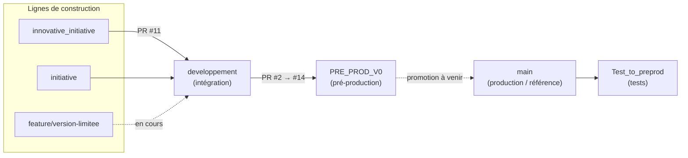
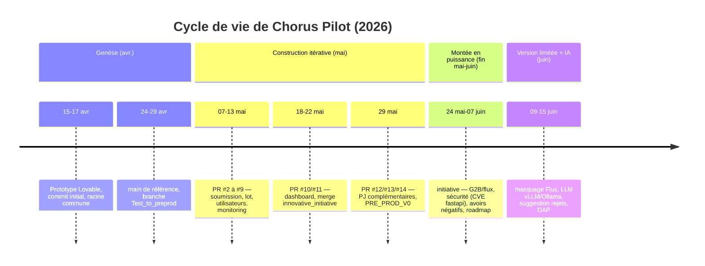
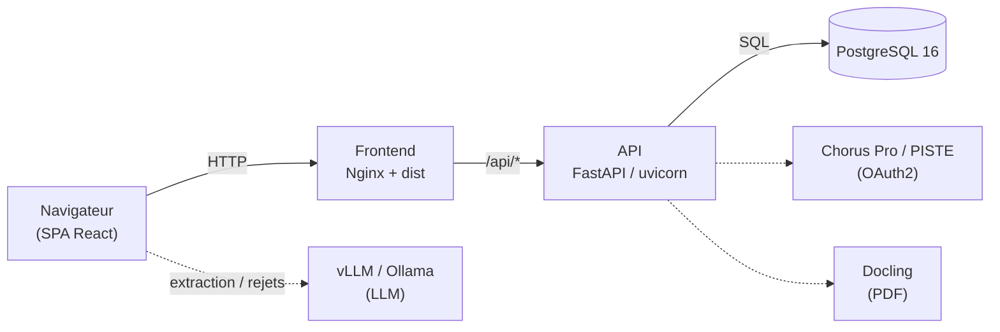

# Dossier d'Architecture Projet (DAP) — Chorus Pilot

**Cycle de vie du produit + architecture technique** — hub d'automatisation de facturation *InvoicePilot*

| | |
|---|---|
| **Projet** | Chorus Pilot — préparation, contrôle, synchronisation et soumission de factures vers Chorus Pro via PISTE |
| **Dépôt** | `JADIAhmedAmine/chorus-path-finder-main` (privé) |
| **Périmètre du document** | Document unique : cycle de vie du produit **et** architecture technique de toutes les briques |
| **Version du document** | 2.0 |
| **Date** | 15 juin 2026 |
| **Statut** | Diffusable (interne projet) |
| **Auteur** | Équipe Gigalis |
| **Branche de rédaction** | `feature/version-limitee` |

> Document interne — ne pas diffuser hors du périmètre projet.

---

## Historique des révisions

| Version | Date | Auteur | Modifications |
|---|---|---|---|
| 1.0 | 15/06/2026 | Équipe Gigalis | Création du DAP technique (markdown versionné), élargi du DAT « version limitée » à l'ensemble du projet. |
| 1.1 | 15/06/2026 | Équipe Gigalis | Enrichissement majeur : synthèse exécutive, chiffres clés, détail par sous-système, « Points forts d'ingénierie », correction du modèle de données. |
| 2.0 | 15/06/2026 | Équipe Gigalis | **Consolidation en un document unique** : fusion du cycle de vie du produit (analyse des 7 branches) et de l'architecture technique. Renumérotation, déduplication. |

> Ce document est **versionné dans le dépôt** (`docs/DAP-chorus-pilot.md`). Toute évolution doit donner lieu à une nouvelle ligne d'historique et à un commit dédié.

---

## Synthèse exécutive

**Chorus Pilot** est une application web d'entreprise qui industrialise le cycle de vie des factures électroniques du secteur public, de la préparation à la soumission et au suivi, en s'intégrant à **Chorus Pro** via la passerelle **PISTE**. Le produit est conçu comme un **hub d'automatisation de facturation** (*InvoicePilot*) : Chorus Pro n'en est que le premier connecteur, l'architecture étant ouverte à d'autres plateformes (PDP, ERP) sans réécriture du cœur métier.

Né mi-avril 2026 d'un prototype d'interface, il est devenu en deux mois une **application full-stack** complète (émission, réception, rejets, recyclage, complétion, dépôt de flux, annuaire, tableau de bord), portée par un **socle technique de qualité industrielle** : architecture en couches, résilience traitée sur chaque chemin, sécurité de bout en bout, et une démarche qualité réelle (~396 tests, dont des tests d'intégration et bout-en-bout sur factures réelles).

Ce document couvre **deux dimensions complémentaires** :

- **Partie A — Cycle de vie** : genèse, modèle de branches, chronologie d'intégration, environnements, état courant et trajectoire.
- **Partie B — Architecture technique** : composants, stack, modèle de données, intégrations, sécurité, qualité, déploiement.

### Chiffres clés du projet

| Indicateur | Valeur |
|---|---|
| Code applicatif | ~47 375 lignes TS/TSX (frontend) + ~18 370 lignes Python (backend) |
| Modules | 57 modules Python · 55 modules `src/lib` · 26 pages · 82 composants React (dont 48 primitives UI) |
| API HTTP exposée | ~73 routes (29 GET / 44 POST), tous routeurs confondus ; serveur principal ~2 960 lignes |
| Endpoints Chorus/CPRO consommés | ≈ 20 (`/factures/v1/*` + `/transverses/v1/*`) |
| Modèle de données | 8 tables ORM · 9 migrations Alembic · multi-tenant |
| Intégrations externes | Chorus Pro/PISTE (qualif + prod), vLLM/Ollama, Docling, annuaire/G2B |
| Tests automatisés | ~396 cas (151 front Vitest + 245 back unittest), ~9 400 lignes ; corpus de 19 PDF réels |
| Sécurité | RBAC 4 rôles · JWT HS256 · bcrypt · CI secret-guard + npm/pip audit hebdomadaire |
| Historique Git | 80 commits sur ~2 mois (15/04 → 15/06/2026) · 7 branches · 13 PR d'intégration |

---

## Table des matières

**Partie A — Cycle de vie du produit**
1. [Genèse et vision](#1-genèse-et-vision)
2. [Modèle de branches et de promotion](#2-modèle-de-branches-et-de-promotion)
3. [Chronologie du cycle de vie](#3-chronologie-du-cycle-de-vie)
4. [Environnements et portes de maturité](#4-environnements-et-portes-de-maturité)
5. [État courant](#5-état-courant)
6. [Trajectoire à venir (roadmap produit)](#6-trajectoire-à-venir-roadmap-produit)
7. [Observations de processus et recommandations](#7-observations-de-processus-et-recommandations)

**Partie B — Architecture technique**
8. [Contexte et objectifs](#8-contexte-et-objectifs)
9. [Vue d'ensemble de l'architecture](#9-vue-densemble-de-larchitecture)
10. [Architecture applicative](#10-architecture-applicative)
11. [Cœur InvoicePilot et abstraction des providers](#11-cœur-invoicepilot-et-abstraction-des-providers)
12. [Stack technique](#12-stack-technique)
13. [Modèle de données](#13-modèle-de-données)
14. [Synchronisation Chorus → base](#14-synchronisation-chorus--base)
15. [Intégrations externes](#15-intégrations-externes)
16. [Socle Flux / G2B / PDF→Flux / UBL](#16-socle-flux--g2b--pdfflux--ubl)
17. [Assistance LLM (extraction et rejets)](#17-assistance-llm-extraction-et-rejets)
18. [Sécurité](#18-sécurité)
19. [Qualité, tests et robustesse](#19-qualité-tests-et-robustesse)
20. [Déploiement, conteneurisation et CI/CD](#20-déploiement-conteneurisation-et-cicd)
21. [Points forts d'ingénierie](#21-points-forts-dingénierie)

**Partie C — Références**
22. [Variante « version limitée »](#22-variante--version-limitée-)
23. [Gestion de configuration](#23-gestion-de-configuration)
24. [Points d'attention et limites connues](#24-points-dattention-et-limites-connues)
25. [Annexes](#25-annexes)

### Acronymes et définitions

| Terme | Définition |
|---|---|
| DAP | Dossier d'Architecture Projet (le présent document). |
| DAT | Document d'Architecture Technique. |
| Chorus Pro | Portail public de facturation électronique (DGFiP / AIFE). |
| PISTE | Plateforme d'Intermédiation des Services pour la Transformation de l'État (passerelle API + OAuth2). |
| CPRO | API Chorus Pro exposée via PISTE. |
| PDP / PPF | Plateforme de Dématérialisation Partenaire / Portail Public de Facturation. |
| G2B | *Government-to-Business* (annuaire et dépôt de flux). |
| UBL / CII | Formats de facture électronique XML. |
| SIRET / SIREN | Identifiants d'établissement (14 chiffres) / d'entité (9 chiffres). |
| RBAC | *Role-Based Access Control* (contrôle d'accès par rôle). |
| LLM / vLLM | *Large Language Model* / moteur d'inférence compatible API OpenAI. |
| Docling | Service de structuration/OCR de documents PDF. |
| CR | Compte rendu (de dépôt / d'intégration) Chorus. |
| PR | *Pull request* (demande d'intégration). |
| Avoir | Facture à montant négatif (note de crédit). |

---

# Partie A — Cycle de vie du produit

Cette partie **raconte l'histoire de Chorus Pilot** à travers l'analyse de son dépôt Git : genèse, phases de construction, modèle de branches, gouvernance d'intégration, passage de la qualification vers la pré-production, état courant et trajectoire. La reconstitution s'appuie sur des faits vérifiables (topologie des commits, divergence des branches, empreinte de chaque branche, chronologie des PR, roadmap produit).

**Vue d'ensemble chiffrée :** 80 commits · 7 branches · ~2 mois d'activité (15/04 → 15/06/2026) · 13 *pull requests* d'intégration · racine commune `30f4eda` (17/04/2026).

## 1. Genèse et vision

Le produit naît mi-avril 2026 d'un **prototype d'interface** généré avec **Lovable** (l'empreinte subsiste : `package.json` nommé `vite_react_shadcn_ts`, dépendance `lovable-tagger`). Le **commit initial** (`3106e20`, *« Initial clean commit »*) date du **15/04/2026** ; la **racine commune** de toutes les lignes de développement actives est `30f4eda` (*« Progress »*, **17/04/2026**).

Très tôt, le projet dépasse le prototype d'écran pour devenir une **application full-stack** : ajout du backend FastAPI, de l'intégration Chorus/PISTE, de la base PostgreSQL et de la conteneurisation. La vision se fixe (cf. [docs/architecture.md](architecture.md)) : un **hub d'automatisation de facturation** (*InvoicePilot*) dont Chorus Pro n'est que le premier connecteur — et non une PDP.

## 2. Modèle de branches et de promotion

Le projet suit un **flux d'intégration par *pull requests*** avec promotion progressive de la maturité, du développement vers la production.



| Branche | Rôle dans le cycle de vie | Statut |
|---|---|---|
| `main` | Mainline / référence de production. Baseline initiale, point de comparaison. | Stable, **en retard** sur le travail récent (cf. §7). |
| `Test_to_preprod` | Branche de **tests** dérivée de `main`, courte durée de vie. | Historique (figée fin avril). |
| `developpement` | Branche d'**intégration** : reçoit le travail des lignes de construction, source des PR. | Active (jusqu'à fin mai). |
| `innovative_initiative` | **Première ligne** de construction fonctionnelle. | Intégrée (PR #11). |
| `PRE_PROD_V0` | **Candidat de pré-production V0**, consolidé depuis `developpement` via PR. | Pré-prod (figé fin mai). |
| `initiative` | **Montée en puissance** : plus large expansion fonctionnelle (G2B, flux, tests). | Active (jusqu'au 07/06). |
| `feature/version-limitee` | **Livraison courante** : version limitée + IA + documentation. | **Tête courante** (15/06). |

**Empreinte par branche** (nombre de fichiers modifiés vs `main`, par zone) — révèle l'ampleur croissante :

| Branche | `src` | `chorus_python` | `tests` | `alembic` | Lecture |
|---|---|---|---|---|---|
| `innovative_initiative` | 104 | 21 | 4 | 5 | Première vague (front + intégration Chorus). |
| `PRE_PROD_V0` | 104 | 21 | 7 | 5 | Consolidation de la 1ʳᵉ vague. |
| `developpement` | 124 | 25 | 14 | 5 | Intégration continue, renforcement des tests. |
| `initiative` | 165 | 43 | 24 | 9 | Expansion majeure (G2B/flux, schéma, tests). |
| `feature/version-limitee` | 170 | 43 | 24 | 10 | Surcouche version limitée + IA + docs. |

## 3. Chronologie du cycle de vie



### Phase 0 — Genèse et socle (15–29 avril 2026)

Prototype d'interface, puis bascule en application full-stack. Établissement de `main` comme référence (10 commits, jusqu'au 24/04) et d'une première branche de **tests** `Test_to_preprod` (dérivée de `main`, 13 commits, jusqu'au 29/04). Premiers correctifs de soumission, configuration des ports, ajustements esthétiques. **Premier module métier documenté** : extraction PDF (`chorus_python/extraction.py`, 23 motifs de nettoyage — cf. [CHANGES.md](../CHANGES.md)).

### Phase 1 — Construction itérative par PR (7–29 mai 2026)

Le cœur fonctionnel se construit sur `developpement` et se promeut par **13 *pull requests*** (#2 → #14), chacune jalonnant une capacité :

| PR | Date | Apport |
|---|---|---|
| #2 | 07/05 | Correction du format de soumission |
| #3 | 07/05 | Licence |
| #4 | 11/05 | Mise à jour de version |
| #5 | 12/05 | Affinage **soumission par lot** |
| #6 | 12/05 | **Monitoring** + gestion des codes d'accès |
| #7 | 12/05 | Gestion des **utilisateurs** |
| #8 | 12/05 | Reconnaissance de l'**entité de soumission** |
| #9 | 13/05 | Soumission par lot (montée en charge) |
| #10 | 18/05 | **Tableau de bord** (année courante par défaut) |
| #11 | 22/05 | Intégration de `innovative_initiative` |
| #12 | 29/05 | **Pièces jointes complémentaires** |
| #13 / #14 | 29/05 | Consolidation `developpement` → `PRE_PROD_V0` |

À l'issue de cette phase : émission/soumission (unitaire et par lot), gestion des utilisateurs et des accès, monitoring et tableau de bord — le **MVP émission** est en place.

### Phase 2 — Pré-production V0 (29 mai 2026)

`PRE_PROD_V0` consolide `developpement` (PR #13) : **premier candidat de pré-production**. La stack de déploiement (Docker Compose prod, migrations automatiques, CI/CD) est opérationnelle.

### Phase 3 — Montée en puissance fonctionnelle (24 mai – 7 juin 2026)

La ligne `initiative` porte l'**expansion la plus large** (165 fichiers `src`, 43 `chorus_python`, 24 `tests`, 9 migrations) : socle **Flux / G2B**, génération UBL, enrichissement réception, élargissement des tests et du schéma. Cette phase intègre aussi des **marqueurs de maturité** :

- **sécurité de la chaîne d'approvisionnement** : exclusion explicite d'une version compromise de FastAPI (`Exclude fastapi 0.136.3 (MAL-2026-4750)`) ;
- **fidélité aux données réelles** : autorisation des **montants négatifs** (avoirs/rejets) + réparation du *merge* Alembic ;
- **formalisation de la roadmap produit** ([roadmap.md](../roadmap.md), généré le 07/06).

### Phase 4 — Version limitée et assistance IA (9–15 juin 2026, *en cours*)

`feature/version-limitee` (dérivée d'`initiative`) constitue la **livraison courante** :

- **masquage réversible** du socle Flux (drapeau `FLUX_ENABLED`, backend intact — cf. §22) ;
- **assistance LLM** branchée sur l'extraction (vLLM/Ollama — cf. §17) ;
- **suggestion de traitement des rejets** (rejet / recyclage / suspension) ;
- **paramétrage des ports hôtes** Docker (isolation multi-instances) ;
- correctif Alembic ; **documentation d'architecture** (le présent DAP).

C'est la branche la plus avancée (+77 commits sur `main`) et la seule à adopter pleinement les **commits conventionnels** (`feat:`, `fix:`, `chore:`, `docs:`) — signe de maturation du processus.

## 4. Environnements et portes de maturité

Le cycle de vie technique s'articule avec les environnements **Chorus/PISTE** :

| Environnement | Cible PISTE | Pilotage |
|---|---|---|
| **Qualification (sandbox)** | `sandbox-*.piste.gouv.fr` | `CHORUS_ENV=qualif` (défaut sécurisé) |
| **Production** | `*.piste.gouv.fr` | `CHORUS_ENV=prod` (activation explicite) |

**Portes de promotion** : *construction* (`initiative`, `feature/*`) → *intégration* (`developpement`) → *tests* (`Test_to_preprod`) → *pré-production* (`PRE_PROD_V0`) → *production* (`main`). Le déploiement de l'environnement de développement est **automatisé** (CI/CD `deploy-development.yml`, déclenché à la réussite de la CI sur `developpement`). La promotion vers la production reste **manuelle** et conditionnée par la validation en qualification.

**Contraintes transverses respectées à chaque *release*** (cf. roadmap) : secrets côté serveur uniquement, pas de journalisation du `cpro-account`, limites de taille des flux (10 Mo / 30 Mo compressé), textes métier rattachés aux sources officielles, re-vérification des spécifications externes.

## 5. État courant (15 juin 2026)

- **Branche livrée** : `feature/version-limitee` — version limitée fonctionnelle, déployable, documentée. Périmètre recentré sur le parcours « factures » + assistance IA, socle Flux masqué (réversible).
- **Pré-production** : `PRE_PROD_V0` reflète l'état de fin mai (avant l'expansion `initiative` et la version limitée).
- **Production / `main`** : reste à la baseline du **24/04** — **non synchronisée** avec le travail des deux derniers mois.
- **Déploiement réel** : instances Docker isolées sur serveur (prod + instance de test), ports paramétrables, déploiement par clé SSH dédiée.

## 6. Trajectoire à venir (roadmap produit)

La [roadmap.md](../roadmap.md) (07/06/2026) séquence la suite du cycle de vie en phases :

| Phase | But | Contenu clé |
|---|---|---|
| **Phase 0** — Vérifier les fondations | Lever l'incertitude réglementaire/API | Verrouiller les tables endpoints/erreurs (Spéc. Externes), OAuth2 (grant/scopes/TTL), calendrier réforme B2B. |
| **Phase 1** — MVP « prévenir & expliquer » | Déposer moins de rejets, comprendre chaque statut | Durcir la **validation pré-dépôt**, lecture des **CR** en langage clair, guidage par statut, parcours *directory-first*, hub `/flux`, onboarding PISTE. |
| **Phase 2** — Récupérer & passer à l'échelle | Transformer rejets/suspensions en récupération guidée | Correction+resoumission guidée, gestion des suspensions, **historique de dépôts persisté**, dépôt en masse + monitoring G2B, **porte de promotion** qualif→prod. |
| **Phase 3** — Insight & différenciation | Valeur de pilotage | **Analytics** (taux de rejet, motifs, délai de paiement), multi-structure/multi-fournisseur, export conformité/audit, reporting. |
| **Phase 4** — Adjacence stratégique | Anticiper la réforme B2B *(à confirmer)* | Évaluation **PDP/PPF**, intégration annuaire/PPF, couverture de formats (Factur-X/UBL/CII). |

## 7. Observations de processus et recommandations

Constats factuels issus de l'analyse, à valeur d'aide à la décision :

1. **Désynchronisation de `main`.** La mainline de production est figée au 24/04, alors que l'essentiel de la valeur (Flux/G2B, IA, version limitée) vit dans `initiative` et `feature/version-limitee`. **Recommandation :** définir et exécuter une **porte de promotion** explicite (`feature/version-limitee` → `PRE_PROD_V1` → `main`).
2. **Pré-production datée.** `PRE_PROD_V0` ne reflète pas les phases 3–4. **Recommandation :** produire un `PRE_PROD_V1` à partir de la livraison courante avant toute mise en production.
3. **Hygiène des messages de commit hétérogène.** Les phases initiales comportent des messages peu explicites (`THIS`, `HHH`, `sdcfvgh`) ; la version limitée adopte les **commits conventionnels**. **Recommandation :** généraliser cette convention et **étiqueter les jalons** (tags `vX.Y` — aucun tag n'existe à ce jour).
4. **Multiplicité des lignes de construction.** `innovative_initiative`, `initiative` et `feature/version-limitee` se recouvrent. **Recommandation :** archiver/clore les lignes intégrées pour clarifier l'arbre.
5. **Continuité de la traçabilité.** Le dédoublement événements métier / journaux techniques (cœur InvoicePilot) n'est pas matérialisé en base sur la branche livrée (cf. §13.2 / §24). **Recommandation :** réactiver avant exploitation des modules concernés.

---

# Partie B — Architecture technique

## 8. Contexte et objectifs

### 8.1 Contexte

Chorus Pilot industrialise le traitement des factures Chorus Pro. L'application permet de :

- **synchroniser** depuis Chorus Pro les fournisseurs, clients publics, services exécutants et factures ;
- **consulter et filtrer** les factures émises et reçues (recherche plein-texte, 14 critères de filtre, tri, export CSV) ;
- **préparer** une facture à partir d'un PDF (extraction, génération de payload, contrôle) ;
- **soumettre, recycler, corriger le valideur et compléter** des factures ;
- **gérer les rejets et refus** avec suggestion d'action assistée par IA ;
- **déposer des flux** (UBL/CII, PDF→flux, G2B) et consulter les comptes rendus ;
- **suivre** statuts, *jobs*, journaux d'appels, notifications et tableau de bord de pilotage.

Le produit se positionne comme un **hub d'automatisation de facturation** : il n'est **pas une PDP**. Le principe fondateur posé dès [docs/architecture.md](architecture.md) — « *It is not a PDP* » — est tenu dans le code : le modèle de facture utilise des champs génériques (`channel`, `provider_name`, `external_invoice_id`) et tout le code PISTE est confiné dans un unique provider (cf. §11).

### 8.2 Objectifs techniques

1. Offrir une interface unifiée (SPA) couvrant tout le parcours facture.
2. Centraliser la logique d'intégration Chorus/PISTE **côté serveur** : les secrets ne transitent jamais par le navigateur.
3. Maintenir un **référentiel local** (PostgreSQL) synchronisé avec Chorus, pour la consultation hors des appels coûteux et un fonctionnement dégradé en cas d'indisponibilité.
4. Isoler chaque système externe derrière une **interface provider** commune (extension multi-plateformes).
5. Permettre un **déploiement conteneurisé** reproductible, avec migrations automatisées et isolation multi-instances.

## 9. Vue d'ensemble de l'architecture

Architecture **3-tiers conteneurisée** : un frontend statique (SPA) servi par Nginx, une API applicative Python (FastAPI) et une base PostgreSQL. Les intégrations externes sont appelées par l'API ; l'assistance LLM, optionnelle, est invoquée côté navigateur (proxifiée en développement).



| Tier | Rôle |
|---|---|
| **Frontend** | SPA compilée (Vite) servie en statique par Nginx, qui proxifie `/api` et applique les en-têtes de sécurité. |
| **API** | FastAPI/uvicorn ; intégration Chorus, synchronisation, extraction PDF, authentification, cœur InvoicePilot, flux/G2B. |
| **Base** | PostgreSQL 16, schéma versionné par Alembic, multi-tenant. |
| **LLM** | Extraction et analyse de rejets via vLLM (API OpenAI) ou Ollama ; appel côté navigateur, proxy Vite en développement. |

## 10. Architecture applicative

### 10.1 Frontend (SPA React)

Application **React 18 / TypeScript**, compilée par **Vite 6**. **26 pages** et **30 routes déclaratives** ([src/App.tsx](../src/App.tsx)), chaque route applicative étant doublement enveloppée par une garde d'authentification (`RequireAuth`, redirection vers `/login`) et un *layout* commun (sidebar + header). Plusieurs anciennes routes sont conservées en **redirections de compatibilité**.

**Gestion d'état serveur — TanStack Query.** `QueryClient` configuré avec des défauts explicites (`staleTime` 5 min, `gcTime` 30 min, `retry` 1). **Fabriques de clés typées** (`dbQueryKeys`, `dashboardQueryKeys`) et **invalidation ciblée** après mutation. La liste **pagine de façon transparente** : première page puis parallélisation via `Promise.all`, plafond défensif (`pageSize ≤ 500`).

**Découplage data / présentation.** Communication via `authenticatedFetch` (injection du *Bearer token*) et helpers `fetchJson` centralisés ; un **401 purge la session et redirige**. Montants **normalisés numériquement** (virgule décimale française). Une seconde couche d'accès (`src/data/backend-client.ts`) est paramétrable par **14 variables `VITE_DATA_*`** avec repli local.

**Résilience d'affichage.** *Error Boundary* applicatif (écran de récupération), *warmup* du catalogue de référentiels, et affichage en **cache dégradé** + carte explicative quand la synchronisation Chorus échoue, **tout en restant utilisable**.

**Design system.** **48 primitives** shadcn/ui sur **27 paquets Radix UI**, thématisation **100 % par tokens CSS HSL** (≈103 variables), mode sombre, animations sur mesure, composants communs réutilisables. Ergonomie : double système de *toasts*, formulaires accessibles, tableaux navigables au clavier, graphiques Recharts thématisés.

### 10.2 Backend (API FastAPI)

Serveur **FastAPI** ([scripts/chorus_submit_server.py](../scripts/chorus_submit_server.py), ~2 960 lignes) structuré en couches :

| Couche | Fichiers clés | Rôle |
|---|---|---|
| Client HTTP bas niveau | `client.py`, `config.py`, `files.py` | OAuth2 PISTE, en-têtes CPRO, appels HTTP, masquage des journaux. |
| Services d'orchestration | `service.py`, `soumission.py`, `reception.py`, `submission_state.py` | Préparation/soumission/réception, machine à états. |
| Modules de domaine **purs** | `payload.py`, `recycle_policy.py`, `chorus_cr.py`, `errors.py` | Calculs et règles testables sans réseau. |
| Persistance | `db/` (entities, repositories, sync, scheduler, schemas, session, api, config) | ORM, accès données, synchronisation, ordonnanceur. |
| Cœur générique | `invoicepilot/` + `providers/` | Cycle de vie produit, abstraction des plateformes (cf. §11). |
| Socle Flux / G2B | `chorus_flux_*.py`, `chorus_pdf_to_flux_*.py`, `chorus_ubl_generator.py`, `g2b_*.py` | Dépôt de flux, détection, conversion, UBL, annuaire (cf. §16). |
| Authentification & audit | `auth.py`, `audit.py` | JWT, RBAC, journal d'audit (cf. §18). |

L'API gère le **cycle de vie complet** de la facture côté émission (`/api/chorus/submit`, `/recycle`, `/validator/correct`) et réception (`/api/reception/consult`, `/consult-bulk`, `/process`, `/complete`, `/download`), plus les services transverses. Au total, **~73 routes HTTP** sont exposées tous routeurs confondus.

Robustesse opérationnelle : **re-exécution automatique dans le virtualenv** si une dépendance manque ; **traçabilité de chaque appel Chorus** ; **persistance et ordonnanceur optionnels** avec dégradation propre ; consultation par lot **bornée à 50 identifiants** et tolérante aux échecs unitaires.

### 10.3 Persistance

**PostgreSQL 16**, via **SQLAlchemy 2** (ORM typé, base `MappedAsDataclass`) et **psycopg 3**. Schéma versionné par **Alembic** (cf. §13). Modèle **multi-tenant de bout en bout**, isolation appliquée jusqu'à l'API (HTTP 403 pour un tenant étranger).

## 11. Cœur InvoicePilot et abstraction des providers

Le projet maintient un **cycle de vie de facture générique** ([chorus_python/invoicepilot/](../chorus_python/invoicepilot/)), indépendant de la plateforme cible.

**Cycle de vie interne** (9 statuts propres, `InvoicePilotStatus`) :

```text
UPLOADED -> EXTRACTED -> TO_VALIDATE -> READY_TO_SUBMIT
READY_TO_SUBMIT -> SUBMITTED -> ACCEPTED / REJECTED / PAID / ERROR
```

**Mapping défensif des statuts externes.** Deux tables projettent ~23 libellés Chorus Pro et ~13 statuts hérités vers le cycle interne, avec normalisation et **valeurs de repli** : aucun statut inconnu ne peut faire échouer le système. Statuts interne et Chorus conservés dans **deux colonnes distinctes**.

**Contrat provider unifié (pattern Strategy via `typing.Protocol`).** L'interface `InvoiceProvider` expose `validate_payload`, `submit_invoice`, `get_status`, `cancel_invoice` et échange des *dataclasses* figées. Le `Protocol` `runtime_checkable` permet d'ajouter un provider conforme **sans dépendance d'import vers le cœur**.

| Provider | Statut | Rôle |
|---|---|---|
| `CHORUS_PRO` | Actif (V1) | Encapsule l'OAuth PISTE, l'upload et la soumission (délègue à `ChorusSubmissionService`). |
| `MOCK` | Disponible | Provider local pour tests/démos sans appel PISTE. |
| `FUTURE_PDP` | Squelette conforme | Marque la PDP comme connecteur futur. |
| `ODOO` (ERP) | Amorcé | `ERPConnector`/`OdooConnector` produisant un import normalisé. |

**Services découplés.** `RoutingService` sélectionne le provider par nom puis par canal métier (`PUBLIC_SECTOR → Chorus`), avec **cache d'instances** et **constructeur injectable**. `ValidationService` applique des règles **produit** complétées par la validation **plateforme** du provider. `InvoiceService.submit_prepared_payload` orchestre la soumission avec **gestion d'erreur à trois niveaux** (exception → `ERROR` + journalisation ; refus métier ; succès) et messages **utilisateur** distincts des messages **techniques**.

**Traçabilité dédoublée (conçue).** Le système distingue **événements métier** (`invoice_events`) et **journal technique** (`api_logs`). ⚠️ Sur la branche livrée, cette persistance n'est **pas matérialisée** (cf. §13.2 et §24).

## 12. Stack technique

### 12.1 Frontend

| Composant | Version | Rôle |
|---|---|---|
| React / React DOM | 18.3 | Bibliothèque UI |
| Vite | 6.x | Bundler / serveur de dev (+ proxys PISTE/Chorus/LLM) |
| TypeScript | 5.8 | Typage statique |
| shadcn/ui + Radix UI | 27 paquets | Composants d'interface (48 primitives) |
| Tailwind CSS | 3.4 | Styles + thématisation par tokens |
| TanStack Query | 5.x | Cache / requêtes serveur |
| React Router | 6.x | Routage SPA (30 routes) |
| react-hook-form + zod | — | Formulaires + validation |
| recharts, sonner, lucide-react | — | Graphes, toasts, icônes |

### 12.2 Backend

| Composant | Version | Rôle |
|---|---|---|
| Python | 3.12 | Langage |
| FastAPI / uvicorn[standard] | ≥ 0.110 / ≥ 0.29 | Framework API / serveur ASGI |
| SQLAlchemy / Alembic | 2.x / 1.13+ | ORM / migrations |
| psycopg[binary] | 3.x | Pilote PostgreSQL |
| pydantic / pydantic-settings | 2.x | Validation / configuration |
| APScheduler | 3.10+ | Synchronisation planifiée |
| PyJWT + bcrypt | — | Authentification (jetons + hachage) |
| PyMuPDF, pdfplumber, pypdf | — | Extraction PDF locale |
| requests / httpx | — | Appels HTTP (PISTE, Docling, vLLM, G2B) |
| defusedxml | — | Parsing XML sécurisé |

### 12.3 Infrastructure

PostgreSQL 16 (alpine), Nginx 1.27 (alpine), Node 20 (build), Python 3.12-slim, Docker & Docker Compose. **Versions de base épinglées**, dépendances bornées par plages (reproductibilité).

## 13. Modèle de données

**8 tables** matérialisées ([chorus_python/db/entities.py](../chorus_python/db/entities.py)), toutes porteuses d'une colonne `tenant_id` (FK vers `tenants` en `ON DELETE RESTRICT`) et d'horodatages gérés **côté serveur** :

| Table | Description |
|---|---|
| `tenants` | Locataires (multi-tenant) ; tenant par défaut configurable. |
| `suppliers` | Fournisseurs synchronisés ; unicité `(tenant_id, chorus_supplier_code)`. |
| `public_customers` | Clients publics (structures destinataires) ; unicité `(tenant_id, code_destinataire)`. |
| `public_services` | Services exécutants rattachés aux clients publics. |
| `invoices` | Factures (émission/réception) ; **statut interne et statut Chorus séparés**, montants `Numeric(15,2)`, clé d'idempotence `(supplier_id, supplier_invoice_number)`, indices ciblés. |
| `invoice_lines` | Lignes de facture (`Numeric(15,4)`, *CheckConstraint* `quantity ≥ 0`, `unit_price_ht ≥ 0`). |
| `sync_runs` | Journal d'audit des synchronisations (statut dérivé, `payload_summary` JSONB). |
| `chorus_flux_deposits` | Dépôts de flux et comptes rendus (module Flux). |

Conception soignée : montants en `Numeric` (jamais en flottant), **index composites alignés sur les requêtes réelles**, cascades choisies finement, anticipation du pipeline LLM (`extraction_confidence`, `requires_human_review`).

### 13.1 Point d'attention — montants négatifs

La migration `20260609_0006_drop_invoice_amount_positive_constraints` **supprime les contraintes** `total_* ≥ 0` (`DROP CONSTRAINT IF EXISTS`, *downgrade* réversible). Motif documenté : Chorus Pro renvoie des **avoirs** et des factures **rejetées** à montants négatifs.

### 13.2 Tables conçues mais non matérialisées sur la branche livrée

Le cœur InvoicePilot référence `invoice_events` et `api_logs`. Sur `feature/version-limitee`, **ces tables ne sont pas définies** dans `entities.py` (cohérent avec la réduction de périmètre). La conception reste présente au niveau des services ; matérialisation et exposition API à réactiver pour exécuter ces modules (cf. §24).

### 13.3 Migrations Alembic

9 révisions formant un historique avec **branche et merge** : deux branches divergent (cœur InvoicePilot `20260522_0001` ; dépôts de flux `20260530_0003/0004`), réconciliées par **`e7a4bd3e24d6_merge_alembic_heads`**. `env.py` active `compare_type=True` (NullPool). Migrations d'enrichissement **additives/nullable**. La production applique `alembic upgrade head` automatiquement (service `migrate`, cf. §20).

## 14. Synchronisation Chorus → base

La synchronisation ([chorus_python/db/sync.py](../chorus_python/db/sync.py)) est l'un des composants les plus aboutis.

**Trois modes adaptatifs** (`recent` / `delta` / `full`). Le mode `delta` réalise un *count-check* distant, **bascule en `full`** si la base est vide (amorçage), et applique une **marge de sécurité de 24 h** pour les dépôts antidatés. Le mode `full` plafonne la page à 5000.

**Idempotence rigoureuse.** Identifiants déterministes (`chorus-<id>`, repli `uuid5`), réconciliation par clé métier, **upsert PostgreSQL** (`ON CONFLICT DO UPDATE`). Aucun doublon même si l'identifiant Chorus change.

**Robustesse.** Chaque facture traitée dans un **savepoint** (`begin_nested()`) : un échec unitaire est compté **sans casser le lot**. Coercitions absorbant le typage lâche des payloads. Totaux manquants reconstruits par arithmétique.

**Concurrence maîtrisée.** Verrou consultatif **transactionnel** (`pg_try_advisory_xact_lock`, clé `blake2b`) avec court-circuit hors PostgreSQL (testabilité) ; sync concurrente marquée `skipped` sans erreur.

**Audit.** *Context manager* `SyncRunContext` calculant un **statut dérivé** (`success` / `partial` / `failed`) et un `payload_summary` JSONB détaillé.

**Ordonnanceur APScheduler.** Amorçage `full` au démarrage et sync `delta` périodique, avec **`max_instances=1` + `coalesce`**, intervalle planché à 60 s, isolation des erreurs par fournisseur.

## 15. Intégrations externes

### 15.1 Chorus Pro via PISTE (OAuth2)

Jeton OAuth2 par grant **`client_credentials`** (`oauth.piste.gouv.fr`), **mis en cache** ; double mode (clé d'API ou `Bearer`). En-têtes CPRO sur chaque appel, dont `cpro-account` (base64 `login:password`, **construit côté serveur**). **Deux environnements préconfigurés** (`qualif`/`prod`), résolution des identifiants **en cascade**, **override par requête** sans redémarrage. Sécurité par défaut : `qualif` tant que `CHORUS_ENV` ≠ `prod`.

### 15.2 vLLM / Ollama — cf. §17. · 15.3 Docling

Service de structuration PDF (`DOCLING_SERVER_URL`), en complément de l'extraction locale selon `PDF_EXTRACTION_ENGINE`, avec réparation par rastérisation et repli local.

### 15.4 Annuaire / G2B — cf. §16.

## 16. Socle Flux / G2B / PDF→Flux / UBL

Au-delà de la soumission unitaire, Chorus Pilot couvre le **dépôt par flux** (factures XML) et l'écosystème **G2B**.

- **Moteur de détection multi-format** ([chorus_flux_detector.py](../chorus_python/chorus_flux_detector.py), ~930 l.) : identification du format réel (UBL/CII/PDF/conteneur), extraction de la facture XML embarquée, métadonnées normalisées, compatibilité `syntaxeFlux`.
- **Pré-contrôle métier avant dépôt** ([chorus_flux_business_validator.py](../chorus_python/chorus_flux_business_validator.py), ~556 l.) : validation *fail-fast* avant `/v1/deposer/flux`, **allowlist fournisseur configurable** (permissif/allowlist/strict), extraction parties et sous-totaux TVA (UBL et CII).
- **Pipeline PDF → flux** : `detect → extract → validate-draft → generate-xml → validate-xml → deposer-generated`, avec **génération UBL** ([chorus_ubl_generator.py](../chorus_python/chorus_ubl_generator.py)).
- **Clients G2B asynchrones** : dépôt avec **checksum**, *healthcheck*, statut, *polling* ; annuaire (normalisation SIREN/SIRET, validation de destinataire).
- **Explicabilité « grand public »** : traduction des erreurs, recommandation du `codeInterface`, diagnostics de configuration PISTE.
- **Persistance et CR** : dépôts persistés (`chorus_flux_deposits`), synchronisation des comptes rendus, stats, rafraîchissement *batch*.

L'espace « Flux » ([docs/FLUX_HUB.md](FLUX_HUB.md)) applique une **règle éditoriale stricte** : tout texte d'aide est rattaché aux sources officielles, toute règle non confirmée marquée « à vérifier » — **aucune valeur inventée**.

> Dans la **version limitée**, ce socle est masqué côté interface (réversible, backend intact — cf. §22).

## 17. Assistance LLM (extraction et rejets)

Couche d'intelligence **optionnelle** par-dessus une extraction heuristique complète, selon une architecture **fail-safe stricte**.

**Client provider-aware unifié** ([src/lib/llm/client.ts](../src/lib/llm/client.ts)) : bascule selon `GEN_PROVIDER` entre **vLLM** (API OpenAI) et **Ollama** (API native) — changement de moteur par simple variable d'environnement. Six variables `GEN_*` ; garde `canUseLlmExtraction`.

**Extraction « heuristique d'abord, affinage ensuite ».** Heuristiques exhaustives avec scores de confiance, puis — **si et seulement si** un LLM est configuré — affinage via un prompt à **règles anti-pièges** (codes TVA `TV12` ≠ taux 12 %, priorité du bloc HT/TVA/TTC, SIRET 14 chiffres). Fusion **conservatrice** : les champs critiques déjà extraits ne sont **jamais écrasés**.

**Robustesse.** À chaque maillon (config absente, échec réseau, *timeout*, JSON non parsable), **repli automatique sur les heuristiques**. Réconciliation arithmétique des totaux (> 0,05 €). Appels court-circuités en test.

**Suggestion de traitement des rejets** ([rejectionAnalysis.ts](../src/lib/chorus/rejectionAnalysis.ts)) : analyse du **motif Chorus** → action contrainte à 5 valeurs, **liste blanche des champs corrigeables**.

| Action | Aiguillage |
|---|---|
| `RESOUMETTRE` | `/invoices/new?invoiceId=X&correction=1` (pré-remplie) |
| `RECYCLER` | Fiche facture (recyclage) |
| `COMPLETER` | Fiche facture (complétion d'une suspendue) |
| `CONTACTER_CLIENT` | Information (blocage côté client) |
| `AUCUNE` | Information (ex. doublon) |

La carte de suggestion affiche **explicitement la provenance** (badge « IA » vs « Règles »). En l'absence de LLM, repli heuristique par mots-clés.

**Extraction PDF backend en défense en profondeur** : [extraction.py](../chorus_python/extraction.py) combine **PyMuPDF + pdfplumber + Docling** (réparation par rastérisation, réconciliation des totaux). Posture explicite : extraction **purement locale**, **aucun envoi externe**, validation humaine obligatoire.

## 18. Sécurité

Défense en profondeur, de l'authentification au reverse proxy et à la CI :

- **Authentification & RBAC.** JWT **HS256** (TTL 12 h), mots de passe **bcrypt** (comparaison en temps constant). **4 rôles** (`DEPOSANT`, `GESTIONNAIRE`, `ADMINISTRATEUR`, `AUDITEUR`) ; `require_submit_permission` bloque les écritures pour la consultation seule (403).
- **Secrets côté serveur uniquement.** Identifiants PISTE/CPRO jamais renvoyés au client ; `.env`, `.env.local`, `config/auth-users.json` **exclus du dépôt** et fournis au déploiement. Navigateur → Nginx → FastAPI → `chorus_python` (jamais d'appel direct avec secrets).
- **Masquage des journaux** (`[masque]`, base64 tronqué, emails/numéros masqués), débogage des payloads **désactivé par défaut**.
- **Audit immuable** des actions sensibles via *middleware* (utilisateur, statut, durée, erreur).
- **Reverse proxy durci** : `X-Frame-Options: DENY`, `X-Content-Type-Options: nosniff`, `Referrer-Policy`, `Permissions-Policy`, limite d'upload (80 Mo), cache immuable assets / `no-store` index (HSTS prévu sous HTTPS).
- **Parsing XML sécurisé** (`defusedxml`).
- **Garde-fous CI** : blocage des `.env*` suivis, scan regex des clés sensibles, audits `npm`/`pip` hebdomadaires.

## 19. Qualité, tests et robustesse

**Double base de tests** : **frontend** (Vitest, jsdom) ~27 fichiers / **151 cas** ; **backend** (unittest) 24 fichiers / **245 fonctions** ; soit **~396 cas**, ~9 400 lignes.

- **Tests d'intégration au niveau routes** (FastAPI `TestClient`) sur 7 fichiers backend (flux, PDF→flux, dépôts, G2B), avec configurations d'allowlist permissif/strict.
- **Tests bout-en-bout sur corpus réel** : **19 factures PDF réelles** partagées front/back, extraction stricte (100 % des champs), vérification **HT + TVA = TTC**, test de **déterminisme**.
- **Test de fumée *live* vers PISTE** (`npm run test:chorus:live`) : `access_token` réel, `cpro-account`, *timeouts* 30 s, code de sortie CI.
- **Déterminisme** : réinitialisation de ~30 variables `VITE_*` et *mocks* réseau.
- **Densité de cas d'erreur** : états de soumission, parsing d'erreurs, contrôle d'accès multi-tenant (403).
- **Outillage** : ESLint 9, TypeScript en projets référencés, [README_TESTING.md](../README_TESTING.md).

## 20. Déploiement, conteneurisation et CI/CD

### 20.1 Conteneurisation

- **Backend** ([Dockerfile.backend](../Dockerfile.backend)) : `python:3.12-slim`, **utilisateur non-root dédié**, `HEALTHCHECK` sur `/health`, lancement `uvicorn`.
- **Frontend** ([Dockerfile.frontend](../Dockerfile.frontend)) : **build multi-stage** (`node:20-alpine` → `nginx:1.27-alpine`), image finale = **artefacts statiques uniquement** ; configuration injectée par ~40 `ARG/ENV` (qualif/prod distincts, config LLM).
- **`.dockerignore`** exclut `.git`, `.venv`, `node_modules`, `dist`, `.env*` — surface réduite, pas de fuite de secrets.

### 20.2 Orchestration

| Fichier | Rôle |
|---|---|
| [docker-compose.yml](../docker-compose.yml) | Dev / déploiement simple (postgres, chorus-api, frontend). |
| [docker-compose.prod.yml](../docker-compose.prod.yml) | Production : service **`migrate`** (`alembic upgrade head`) avant l'API, **`annuaire-permissions`**, **ordre de démarrage piloté par la santé**, API en `expose` interne. |

**Isolation multi-instances** : ports paramétrables (`POSTGRES_HOST_PORT`, `CHORUS_API_HOST_PORT`, `APP_HTTP_PORT`) + noms de projet Compose distincts.

```bash
docker compose up -d --build       # construction + démarrage
docker compose logs -f chorus-api  # suivi des logs
```

### 20.3 CI/CD (GitHub Actions)

- **`ci.yml`** : frontend (`npm ci` → lint → `vitest run` → `vite build`), backend (`compileall` + `unittest`), `docker compose config` (validation du manifeste prod).
- **`security.yml`** : **secret-guard**, `npm audit`, `pip-audit`, **scan hebdomadaire**.
- **`deploy-development.yml`** : déploiement à la réussite de la CI sur `developpement`, **SSH durci**, **`git pull --ff-only`**, reconstruction Compose.

## 21. Points forts d'ingénierie

1. **Architecture en couches et découplage produit/plateforme** (modules purs testables, abstraction provider par `Protocol`, cœur indépendant de Chorus).
2. **Résilience sur chaque chemin** (repli LLM → heuristiques, cache dégradé frontend, sync idempotente avec *savepoints* et verrou consultatif, *Error Boundary*).
3. **Idempotence et intégrité des données** (upserts `ON CONFLICT`, `Numeric`, multi-tenant `RESTRICT`, audit `sync_runs`).
4. **Sécurité de bout en bout** (secrets serveur, RBAC, masquage, en-têtes Nginx, garde-fous CI).
5. **Fidélité au contrat Chorus** (machine à états `GDP_MSG_11.001`, recyclage par liste blanche, 9 états de CR V5.00, erreurs normalisées — aucune règle inventée).
6. **Qualité vérifiable** (~396 tests, intégration + E2E sur factures réelles, smoke *live* PISTE).
7. **Exploitabilité** (non-root, healthchecks, migrations auto, isolation multi-instances, CD durci, builds reproductibles).
8. **Souci de l'utilisateur final** (erreurs traduites en actions, transparence IA/Règles, explicabilité G2B, contenus sourcés).

---

# Partie C — Références

## 22. Variante « version limitée »

La **version limitée** (branche `feature/version-limitee`, cf. [DAT-version-limitee.tex](DAT-version-limitee.tex)) restreint la surface **visible**, **sans supprimer de code**, de façon **réversible** :

| Aspect | Mise en œuvre |
|---|---|
| Masquage du socle Flux | Drapeau `FLUX_ENABLED` ([src/lib/featureFlags.ts](../src/lib/featureFlags.ts), défaut *off*). Commute **routes** (`<Navigate>`) et **navigation**. **Backend inchangé.** |
| Extraction LLM (vLLM) | Provider `vllm` (API OpenAI), variables `GEN_*` exposées au build, affinage en fin d'extraction. |
| Suggestion de rejets | Analyse LLM + repli heuristique ; bouton « Resoumettre » pré-rempli. |

Le backend reste **fonctionnellement complet** : seules des surfaces de l'interface sont masquées.

## 23. Gestion de configuration

- **Dépôt Git privé** ; modèle de branches et chronologie : voir **Partie A (§2–§3)**. Conventions de commit : *Conventional Commits* sur les contributions récentes.
- **Schéma de base** versionné par **Alembic** (cf. §13.3) ; toute évolution = une migration dédiée.
- **Configuration applicative** externalisée en variables d'environnement et fichiers non versionnés ; [.env.example](../.env.example) documente les clés.
- **Documentation** : ce DAP est **versionné dans `docs/`** ; les évolutions mettent à jour l'historique des révisions.

## 24. Points d'attention et limites connues

- **Compte technique PISTE partagé.** Deux instances synchronisant avec le **même** compte technique provoquent des 401 (corps vide, probablement par **IP**). Recommandation : une seule instance de synchronisation active par compte ; instances de test **passives** (`SYNC_CRON_ENABLED=false`, `SYNC_STARTUP_FULL_SYNC=false`).
- **Persistance InvoicePilot non matérialisée sur la branche livrée** (`invoice_events`/`api_logs` référencés mais absents — à réactiver avant usage ; n'affecte pas le parcours facture livré).
- **Désynchronisation de `main`** (figée au 24/04) — cf. recommandations §7.
- **Badge environnement** : « Production / Sandbox » dépend de `VITE_CHORUS_ENV` **figé au build** (lu dans `.env` racine), indépendant du backend ; `docker compose` ne lit pas `.env.local` pour les *build args* frontend.
- **Encodage `.env`** : doit être **UTF-8** (sinon `load_dotenv` échoue au démarrage).
- **Fichiers non versionnés** : `.env`, `.env.local`, `config/auth-users.json` à fournir manuellement après un clone.
- **Appel LLM côté navigateur** : nécessite l'accessibilité réseau du serveur d'inférence (cohérence http/https — *mixed content*).
- **Typage TS applicatif non strict** (`strict`/`strictNullChecks` désactivés côté app ; outillage en mode strict).

## 25. Annexes

### 25.1 Arborescence (extrait)

```text
chorus-path-finder/
├─ src/                          # Frontend React (~47k lignes, 26 pages, 82 composants)
│  ├─ pages/                     # Écrans (InvoiceList, EmissionRejections, Dashboard, ...)
│  ├─ components/                # chorus/, flux/, layout/, common/, ui/ (48 primitives)
│  ├─ data/                      # backend-client.ts (couche data paramétrable)
│  └─ lib/
│     ├─ featureFlags.ts         # FLUX_ENABLED
│     ├─ llm/                    # config.ts, client.ts, ollama.ts
│     ├─ chorus/                 # extraction.ts, rejectionAnalysis.ts, ...
│     ├─ flux/  g2b/             # socle Flux / G2B
│     └─ queries/  references/   # TanStack Query, référentiels
├─ chorus_python/                # Backend (~18k lignes, 57 modules)
│  ├─ db/                        # entities.py, sync.py, scheduler.py, api.py, ...
│  ├─ invoicepilot/              # cœur générique (services + statuts)
│  ├─ providers/                 # base.py, chorus_pro.py, mock.py, future_pdp.py
│  ├─ chorus_flux_*.py           # détection / validation / routes flux
│  ├─ chorus_pdf_to_flux_*.py    # pipeline PDF→flux + chorus_ubl_generator.py
│  └─ g2b_*.py                   # annuaire / flux / explainer / recommandation / diagnostics
├─ scripts/chorus_submit_server.py   # Application FastAPI (~2960 lignes)
├─ alembic/versions/             # 9 migrations
├─ docker/nginx/default.conf     # Reverse proxy durci
├─ docker-compose.yml / .prod.yml
├─ Dockerfile.backend / Dockerfile.frontend
├─ tests/  src/test/             # ~396 cas, corpus 19 PDF réels
└─ .github/workflows/            # ci.yml, security.yml, deploy-development.yml
```

### 25.2 Principaux points d'entrée API

| Endpoint | Rôle | Accès |
|---|---|---|
| `/health` | Sonde | public |
| `/api/auth/login`, `/me`, `/change-password`, `/audit-log` | Authentification & audit | mixte |
| `/api/db/sync/suppliers`, `/sync/invoices` | Synchronisation Chorus → DB | auth |
| `/api/db/invoices`, `/suppliers`, … | Lecture des données (multi-tenant) | auth |
| `/api/chorus/submit`, `/recycle`, `/validator/correct` | Soumission / recyclage / correction valideur | submit |
| `/api/reception/consult`, `/consult-bulk`, `/process`, `/complete`, `/download` | Réception | auth |
| `/api/extract-pdf-text` | Extraction PDF | auth |
| `/api/chorus/oauth-token`, `/siret/info`, `/structures/active-destinataire`, `/annuaire/sync` | Services transverses | auth |
| `/api/chorus/flux/*`, `/api/.../g2b/*`, `/api/.../pdf-to-flux/*` | Socle Flux / G2B / PDF→flux | submit |

### 25.3 Synthèse des branches

| Branche | Commits | Période | Avance / `main` | Tête |
|---|---|---|---|---|
| `main` | 10 | 15/04 → 24/04 | — (référence) | `ADD` |
| `Test_to_preprod` | 13 | 15/04 → 29/04 | +3 | `ADD` |
| `developpement` | 63 | 15/04 → 29/05 | +59 | Merge `initiative` |
| `PRE_PROD_V0` | 52 | 15/04 → 29/05 | +48 | Merge PR #13 |
| `innovative_initiative` | 38 | 15/04 → 22/05 | +34 | `UPGRADE` |
| `initiative` | 73 | 15/04 → 07/06 | +69 | ` TH'` |
| `feature/version-limitee` | 81 | 15/04 → 15/06 | +77 | `docs(dap): …` |

*(Toutes les lignes actives partagent la racine `30f4eda` du 17/04/2026 ; `Test_to_preprod` diverge de `main` le 24/04.)*

### 25.4 Documents liés

- [docs/DAT-version-limitee.tex](DAT-version-limitee.tex) — DAT de la version limitée (LaTeX).
- [docs/documentation-technique-chorus-path-finder.tex](documentation-technique-chorus-path-finder.tex) — documentation technique détaillée.
- [docs/architecture.md](architecture.md) — vision produit InvoicePilot et providers.
- [docs/FLUX_HUB.md](FLUX_HUB.md) — espace « Flux » (organisation, sources officielles).
- [roadmap.md](../roadmap.md) — roadmap produit (phases 0–4).
- [CHANGES.md](../CHANGES.md) — journal de changements (extraction PDF).
- [README.md](../README.md) / [README_TESTING.md](../README_TESTING.md) — démarrage, exploitation, tests.
- [docs/guide-utilisateur-chorus-path-finder.tex](guide-utilisateur-chorus-path-finder.tex) — guide utilisateur.
