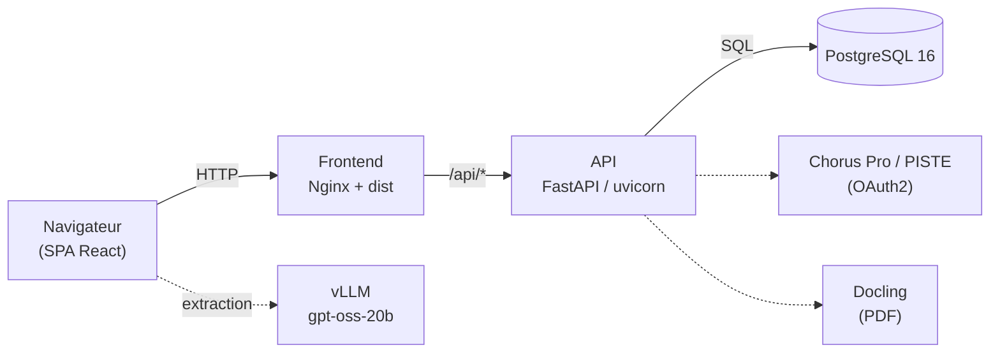

# Dossier d'Architecture Projet (DAP) — Technique

**Projet : Chorus Pilot** (hub d'automatisation de facturation — InvoicePilot)

| | |
|---|---|
| **Projet** | Chorus Pilot — préparation, contrôle, synchronisation et soumission de factures vers Chorus Pro via PISTE |
| **Dépôt** | `JADIAhmedAmine/chorus-path-finder-main` (privé) |
| **Périmètre du document** | Architecture technique du projet (toutes briques) |
| **Version du document** | 1.0 |
| **Date** | 15 juin 2026 |
| **Statut** | Diffusable (interne projet) |
| **Auteur** | Équipe Gigalis |
| **Branche de rédaction** | `feature/version-limitee` |

> Document interne — ne pas diffuser hors du périmètre projet.

---

## Historique des révisions

| Version | Date | Auteur | Modifications |
|---|---|---|---|
| 1.0 | 15/06/2026 | Équipe Gigalis | Création initiale du DAP technique (markdown, versionné). Reprend et élargit le DAT « version limitée » à l'ensemble du projet. |

> Ce document est **versionné dans le dépôt** (`docs/DAP-chorus-pilot.md`). Toute évolution d'architecture doit donner lieu à une nouvelle ligne d'historique et à un commit dédié.

---

## Table des matières

1. [Introduction](#1-introduction)
2. [Contexte et objectifs](#2-contexte-et-objectifs)
3. [Vue d'ensemble de l'architecture](#3-vue-densemble-de-larchitecture)
4. [Architecture applicative](#4-architecture-applicative)
5. [Cœur InvoicePilot et abstraction des providers](#5-cœur-invoicepilot-et-abstraction-des-providers)
6. [Stack technique](#6-stack-technique)
7. [Modèle de données](#7-modèle-de-données)
8. [Intégrations externes](#8-intégrations-externes)
9. [Flux fonctionnels clés](#9-flux-fonctionnels-clés)
10. [Sécurité](#10-sécurité)
11. [Déploiement et exploitation](#11-déploiement-et-exploitation)
12. [Variante « version limitée »](#12-variante--version-limitée-)
13. [Gestion de configuration et versionnement](#13-gestion-de-configuration-et-versionnement)
14. [Points d'attention et limites connues](#14-points-dattention-et-limites-connues)
15. [Annexes](#15-annexes)

---

## 1. Introduction

### 1.1 Objet du document

Ce Dossier d'Architecture Projet (DAP) décrit l'architecture technique de l'application **Chorus Pilot**, solution de gestion du cycle de vie des factures émises et reçues via **Chorus Pro** (portail de facturation électronique du secteur public français), exposé par la passerelle **PISTE**. Il fournit aux équipes techniques une vision complète des composants, des technologies, des intégrations externes, du modèle de données et des modalités de déploiement et d'exploitation.

Il s'appuie sur le code réel du dépôt et complète :

- le **DAT « version limitée »** ([docs/DAT-version-limitee.tex](DAT-version-limitee.tex)), restreint au périmètre de la livraison de démonstration ;
- la **documentation technique** ([docs/documentation-technique-chorus-path-finder.tex](documentation-technique-chorus-path-finder.tex)) et le [README.md](../README.md).

### 1.2 Acronymes et définitions

| Terme | Définition |
|---|---|
| DAP | Dossier d'Architecture Projet (le présent document). |
| DAT | Document d'Architecture Technique. |
| Chorus Pro | Portail public de facturation électronique (DGFiP). |
| PISTE | Plateforme d'Intermédiation des Services pour la Transformation de l'État (passerelle API + OAuth2). |
| PDP | Plateforme de Dématérialisation Partenaire. |
| G2B | Government-to-Business (flux d'échange annuaire / dépôt). |
| UBL | Universal Business Language (format de facture XML). |
| SIRET | Identifiant d'établissement (14 chiffres). |
| LLM | *Large Language Model* (modèle de langage). |
| vLLM | Moteur d'inférence LLM exposant une API compatible OpenAI. |
| Docling | Service de conversion/structuration de documents (OCR / mise en page). |
| Avoir | Facture à montant négatif (note de crédit). |
| SPA | *Single Page Application*. |

---

## 2. Contexte et objectifs

### 2.1 Contexte

Chorus Pilot industrialise le traitement des factures Chorus Pro. L'application permet de :

- **synchroniser** depuis Chorus Pro les fournisseurs, clients publics et factures ;
- **consulter et filtrer** les factures émises et reçues ;
- **préparer** une facture à partir d'un PDF (extraction de texte, génération de payload) ;
- **soumettre, recycler et compléter** des factures ;
- **gérer les rejets et refus** ;
- **suivre** les statuts, *jobs*, journaux d'appels et notifications.

Le produit se positionne comme un **hub d'automatisation de facturation** (nom interne *InvoicePilot*) : il n'est **pas une PDP**. Il se place au-dessus des plateformes de facturation externes pour automatiser validation, routage, soumission et suivi. Le provider de la V1 est **Chorus Pro via PISTE** ; d'autres providers (PDP, ERP) peuvent être ajoutés sans faire de Chorus Pro le cœur du produit (cf. §5).

### 2.2 Objectifs techniques

1. Offrir une interface unifiée (SPA) pour l'ensemble du parcours facture (émission et réception).
2. Centraliser la logique d'intégration Chorus/PISTE côté serveur (les secrets ne transitent jamais par le navigateur en production).
3. Maintenir un **référentiel local** (PostgreSQL) synchronisé avec Chorus pour la consultation et le filtrage hors-ligne des appels coûteux.
4. Isoler les systèmes externes derrière une **interface provider** commune, pour préparer l'extension multi-plateformes.
5. Permettre un **déploiement conteneurisé** reproductible (Docker Compose) avec migrations de schéma automatisées.

---

## 3. Vue d'ensemble de l'architecture

L'application suit une architecture **3-tiers conteneurisée** : un frontend statique (SPA) servi par Nginx, une API applicative Python (FastAPI), et une base PostgreSQL. Les intégrations externes (Chorus Pro via PISTE, vLLM, Docling, annuaire) sont appelées par l'API ; pour le LLM, l'appel peut être émis côté navigateur (proxifié en développement).



| Tier | Rôle |
|---|---|
| **Frontend** | SPA compilée (Vite) servie en statique par Nginx, qui proxifie `/api` vers l'API. |
| **API** | FastAPI/uvicorn ; logique métier Chorus, synchronisation, extraction PDF, authentification, cœur InvoicePilot. |
| **Base** | PostgreSQL 16, schéma géré par Alembic. |
| **LLM** | L'extraction appelle vLLM (API compatible OpenAI) ; appel émis côté navigateur (proxy Vite en développement). |

Le reverse proxy Nginx ([docker/nginx/default.conf](../docker/nginx/default.conf)) sert l'application statique et route `/api/*` vers le service `chorus-api`.

---

## 4. Architecture applicative

### 4.1 Frontend (SPA)

Application **React 18** mono-page, compilée par **Vite 6**, organisée en :

- **pages** ([src/pages/](../src/pages/)) — un écran par parcours métier ;
- **composants** réutilisables ([src/components/](../src/components/), sous-dossiers `chorus/`, `flux/`, `layout/`, `common/`, et la bibliothèque **shadcn/ui** sous `ui/`) ;
- **couche d'accès données et logique** ([src/lib/](../src/lib/)).

La récupération des données passe par **TanStack Query** vers l'API `/api/db/…`. Le routage est assuré par **React Router**. Les formulaires reposent sur **react-hook-form + zod**.

Principaux sous-modules de [src/lib/](../src/lib/) :

| Module | Rôle |
|---|---|
| `chorus/` | Logique Chorus côté front : extraction PDF, construction et validation des payloads de soumission, mappers, statuts, téléchargement, analyse des rejets. |
| `flux/` | Socle « Flux » : dépôts, détection, services annuaire, sources officielles. |
| `g2b/` | Clients G2B (annuaire, flux). |
| `llm/` | Configuration LLM (`config.ts`), client chat partagé *provider-aware* (`client.ts`), prompt d'extraction (`ollama.ts`). |
| `queries/`, `references/` | Requêtes serveur (DB, dashboard) et référentiels (annuaire). |
| `auth/` | Session côté client. |
| `featureFlags.ts` | Drapeaux de fonctionnalités (dont `FLUX_ENABLED`, cf. §12). |

Écrans principaux (extrait de [src/pages/](../src/pages/)) : `Dashboard`, `InvoiceList`, `InvoiceCreate`, `InvoiceDetail`, `ChorusInvoiceDetail`, `EmissionRejections`, `InvoicesToProcess`, `ReceptionProcessing`, `ReceptionInvoiceDetail`, `References`, `Connectors`, `Monitoring`, `Jobs`, `Archives`, `AuditPage`, `SettingsPage`, `FluxHub`, `FluxDepositPage`, `G2BFluxDepositPage`, `PdfToFluxPage`, `Login`.

### 4.2 Backend (API)

Serveur **FastAPI** ([scripts/chorus_submit_server.py](../scripts/chorus_submit_server.py)) exposant :

- une **API de données** (`/api/db/…`) adossée à PostgreSQL (factures, fournisseurs, clients/services publics, synchronisation) ;
- un **pont Chorus / PISTE** (`/api/chorus/…`, `/api/reception/…`) pour la soumission, le recyclage, la complétion, la consultation et le téléchargement ;
- des **services transverses** : extraction PDF (`/api/extract-pdf-text`), jeton OAuth (`/api/chorus/oauth-token`), annuaire, SIRET.

La logique métier est centralisée dans le package **[chorus_python/](../chorus_python/)** :

| Sous-ensemble | Fichiers clés | Rôle |
|---|---|---|
| Client Chorus / PISTE | `client.py`, `config.py`, `auth.py`, `soumission.py`, `reception.py`, `payload.py`, `recycle_policy.py`, `submission_state.py`, `chorus_cr.py` | OAuth2, appels métier, soumission/réception, comptes rendus, politiques de recyclage. |
| Persistance | `db/entities.py`, `db/repositories.py`, `db/session.py`, `db/schemas.py`, `db/api.py`, `db/sync.py`, `db/scheduler.py`, `db/config.py` | ORM, accès données, schémas Pydantic, routes DB, synchronisation, ordonnanceur. |
| Cœur InvoicePilot | `invoicepilot/` (`invoice_service.py`, `validation_service.py`, `routing_service.py`, `status_service.py`, `event_service.py`, `statuses.py`, `erp_connector.py`, `api.py`) | Cycle de vie générique de la facture, événements métier. |
| Providers | `providers/base.py`, `providers/chorus_pro.py`, `providers/mock.py`, `providers/future_pdp.py` | Abstraction des systèmes externes (cf. §5). |
| Socle Flux / G2B | `chorus_flux_*.py`, `chorus_pdf_to_flux_*.py`, `chorus_ubl_generator.py`, `g2b_*.py` | Dépôt de flux, détection, conversion PDF→flux, génération UBL, annuaire G2B. |
| Extraction & fichiers | `extraction.py`, `chorus_pdf_invoice_extractor.py`, `files.py` | Extraction de texte/champs PDF (PyMuPDF, pdfplumber, pypdf). |
| Transverses | `annuaire.py`, `audit.py`, `dashboard.py`, `service.py`, `models.py`, `errors.py` | Annuaire, audit, tableau de bord, modèles, gestion d'erreurs. |

### 4.3 Persistance

**PostgreSQL 16**. Le schéma est versionné par **Alembic** ([alembic/versions/](../alembic/versions/)). L'accès se fait via **SQLAlchemy 2** et **psycopg 3** (DSN `postgresql+psycopg://…`).

---

## 5. Cœur InvoicePilot et abstraction des providers

Au-delà de l'intégration Chorus, le projet maintient un **cycle de vie de facture générique** ([chorus_python/invoicepilot/](../chorus_python/invoicepilot/)), indépendant de la plateforme cible. Les statuts Chorus restent des statuts **externes**, mappés vers ce cycle de vie interne (voir [docs/architecture.md](architecture.md)).

Cycle de vie interne :

```text
UPLOADED -> EXTRACTED -> TO_VALIDATE -> READY_TO_SUBMIT
READY_TO_SUBMIT -> SUBMITTED -> ACCEPTED / REJECTED / PAID / ERROR
```

Les systèmes externes sont isolés derrière une **interface provider** commune ([chorus_python/providers/base.py](../chorus_python/providers/base.py)) :

| Provider | Statut | Rôle |
|---|---|---|
| `CHORUS_PRO` | Actif (V1) | Encapsule l'OAuth PISTE, l'upload et la soumission existants. |
| `MOCK` | Disponible | Provider local pour tests et démonstrations sans appel PISTE. |
| `FUTURE_PDP` | Placeholder | Marque la PDP comme connecteur futur, non comme identité du produit. |
| `ODOO` | Préparé | Forme d'import ERP envisagée (non intégrée). |

Cette séparation permet d'ajouter de nouveaux canaux sans réécrire le cœur métier.

---

## 6. Stack technique

### 6.1 Frontend

| Composant | Version | Rôle |
|---|---|---|
| React / React DOM | 18.3 | Bibliothèque UI |
| Vite | 6.x | Bundler / serveur de dev |
| TypeScript | 5.8 | Typage statique |
| shadcn/ui + Radix UI | — | Composants d'interface |
| Tailwind CSS | 3.4 | Styles utilitaires |
| TanStack Query | 5.x | Cache / requêtes serveur |
| React Router | 6.x | Routage SPA |
| react-hook-form + zod | — | Formulaires + validation |
| recharts, sonner, lucide-react | — | Graphes, toasts, icônes |

### 6.2 Backend

| Composant | Version | Rôle |
|---|---|---|
| Python | 3.12 | Langage |
| FastAPI | ≥ 0.110 | Framework API |
| uvicorn[standard] | ≥ 0.29 | Serveur ASGI |
| SQLAlchemy | 2.x | ORM |
| Alembic | 1.13+ | Migrations de schéma |
| psycopg[binary] | 3.x | Pilote PostgreSQL |
| pydantic / pydantic-settings | 2.x | Validation / configuration |
| APScheduler | 3.10+ | Synchronisation planifiée |
| PyJWT + bcrypt | — | Authentification (jetons + hash) |
| PyMuPDF, pdfplumber, pypdf | — | Extraction PDF locale |
| requests / httpx | — | Appels HTTP (PISTE, Docling, vLLM) |
| defusedxml | — | Parsing XML sécurisé |

### 6.3 Infrastructure

PostgreSQL 16 (alpine), Nginx 1.27 (alpine), Docker & Docker Compose.

---

## 7. Modèle de données

Schéma principal PostgreSQL ([chorus_python/db/entities.py](../chorus_python/db/entities.py), migrations [alembic/versions/](../alembic/versions/)) :

| Table | Description |
|---|---|
| `tenants` | Locataires (multi-tenant) ; tenant par défaut configurable. |
| `suppliers` | Fournisseurs synchronisés depuis Chorus. |
| `public_customers` | Clients publics (structures destinataires). |
| `public_services` | Services exécutants rattachés aux clients publics. |
| `invoices` | Factures (émission/réception) ; métadonnées Chorus, statuts, montants, `channel`, `provider_name`, `external_invoice_id`. |
| `invoice_lines` | Lignes de facture. |
| `sync_runs` | Journal des exécutions de synchronisation Chorus → DB. |
| `chorus_flux_deposits` | Dépôts de flux et comptes rendus (module Flux). |
| `invoice_events` | Événements métier (upload, validation, soumission, synchronisation de statut) — module *invoicepilot*. |
| `api_logs` | Journaux techniques des échanges avec les providers, distincts des événements métier. |

### 7.1 Point d'attention — montants négatifs

La migration `20260609_0006_drop_invoice_amount_positive_constraints` **supprime les contraintes** `total_ht / total_vat / total_ttc ≥ 0` sur `invoices`. Chorus Pro renvoie en effet des **avoirs** et des factures **rejetées** à montants négatifs ; ces contraintes bloquaient la synchronisation.

### 7.2 Migrations

L'historique Alembic ([alembic/versions/](../alembic/versions/)) comprend :

- `20260504_0001_initial_schema`, `20260504_0002_extend_invoice_columns` ;
- `20260522_0001_invoicepilot_core` (cœur InvoicePilot — *branchpoint*) ;
- `20260530_0003_chorus_flux_deposits`, `20260530_0004_flux_deposit_detection`, `20260607_0005_flux_deposit_cr_enrichment` ;
- `20260609_0006_drop_invoice_amount_positive_constraints` ;
- `d55c148e31ff_change_status_reason_label_to_text` ;
- `e7a4bd3e24d6_merge_alembic_heads` (migration de **merge** consolidant les têtes).

Le graphe présentant un *branchpoint* (module *invoicepilot*), une migration de merge réunifie les têtes. La stack de production applique `alembic upgrade head` automatiquement (service `migrate`, cf. §11) ; sur une base manuelle présentant encore plusieurs têtes, utiliser `alembic upgrade heads` (au pluriel).

---

## 8. Intégrations externes

### 8.1 Chorus Pro via PISTE (OAuth2)

L'API obtient un jeton OAuth2 (`oauth.piste.gouv.fr`) à partir d'un `client_id` / `client_secret`, puis émet les appels métier vers `api.piste.gouv.fr` avec, en en-tête, le jeton `Bearer` et le compte technique Chorus (`cpro-account`, base64 de `login:password`).

L'environnement (**qualif** / **prod**) est piloté par `CHORUS_ENV` ; les identifiants sont sélectionnés par suffixe (`CHORUS_PROD_*` / `CHORUS_QUALIF_*`, avec repli sur `VITE_CHORUS_*`).

### 8.2 vLLM (extraction LLM)

Moteur d'inférence exposant une API compatible OpenAI (`/v1/chat/completions`). Configuré via `GEN_PROVIDER=vllm`, `GEN_BASE_URL`, `GEN_MODEL` (`gpt-oss-20b`). Le client ([src/lib/llm/client.ts](../src/lib/llm/client.ts)) est *provider-aware* et gère également **Ollama** (`/api/chat`).

### 8.3 Docling (conversion PDF)

Service externe de structuration de documents PDF (`DOCLING_SERVER_URL`), utilisé en complément de l'extraction locale (PyMuPDF / pdfplumber), selon `PDF_EXTRACTION_ENGINE` (`local` par défaut).

### 8.4 Annuaire / G2B

Référentiel annuaire Chorus servi en statique (volume `chorus_annuaire_data`, `/annuaire/…`) et clients G2B ([chorus_python/g2b_*.py](../chorus_python/), [src/lib/g2b/](../src/lib/g2b/)) pour les échanges annuaire et dépôts de flux.

---

## 9. Flux fonctionnels clés

### 9.1 Synchronisation Chorus → DB

Assurée par **APScheduler** ([chorus_python/db/scheduler.py](../chorus_python/db/scheduler.py)) :

- **synchronisation complète au démarrage** (`SYNC_STARTUP_FULL_SYNC`) ;
- **synchronisation périodique** optionnelle (`SYNC_CRON_ENABLED`, intervalle `SYNC_CRON_INTERVAL_SECONDS`).

Déclenchement manuel : `POST /api/db/sync/suppliers` puis `/sync/invoices`. L'environnement utilisé est résolu via `CHORUS_ENV` ou l'`environment` transmis par le frontend.

### 9.2 Préparation et soumission d'une facture

PDF → extraction de texte (backend) → génération de payload Chorus → upload du PDF → soumission via les API Chorus → suivi des statuts. Les payloads sont construits et validés côté front ([src/lib/chorus/buildSubmissionPayload.ts](../src/lib/chorus/buildSubmissionPayload.ts), `validateSubmissionPayload.ts`) puis relayés par le pont `/api/chorus/submit`.

### 9.3 Extraction PDF assistée par LLM

Le frontend extrait d'abord les champs par heuristiques ([src/lib/chorus/extraction.ts](../src/lib/chorus/extraction.ts)) ; si un LLM est configuré (`canUseLlmExtraction`), il **affine** le résultat via vLLM, avec **repli automatique** sur les heuristiques en cas d'échec/timeout. Côté backend, l'extraction repose sur PyMuPDF/pdfplumber et, optionnellement, Docling.

### 9.4 Réception et traitement

Consultation, traitement et complétion des factures reçues via `/api/reception/consult`, `/process`, `/complete` ([chorus_python/reception.py](../chorus_python/reception.py)).

### 9.5 Traitement des rejets (suggestion LLM)

Sur les factures rejetées / à recycler / suspendues, le module [src/lib/chorus/rejectionAnalysis.ts](../src/lib/chorus/rejectionAnalysis.ts) analyse le **motif Chorus** et propose une action structurée :

| Action | Aiguillage |
|---|---|
| `RESOUMETTRE` | `/invoices/new?invoiceId=X&correction=1` (pré-remplie) |
| `RECYCLER` | Fiche facture (formulaire de recyclage) |
| `COMPLETER` | Fiche facture (complétion d'une suspendue) |
| `CONTACTER_CLIENT` | Information (blocage côté client) |
| `AUCUNE` | Information (ex. doublon) |

La suggestion s'affiche dans le panneau de la liste « Rejets » et sur la fiche facture. En l'absence de LLM, un **repli heuristique** (mots-clés) fournit la même structure.

### 9.6 PDF → Flux (socle Flux)

Détection et conversion d'un PDF en flux Chorus, génération UBL et dépôt G2B ([chorus_python/chorus_pdf_to_flux_service.py](../chorus_python/chorus_pdf_to_flux_service.py), `chorus_ubl_generator.py`). Ce socle est **masqué** dans la version limitée (cf. §12).

---

## 10. Sécurité

- **Authentification** : jetons JWT (PyJWT, secret `APP_AUTH_JWT_SECRET`, durée `APP_AUTH_TOKEN_TTL_SECONDS`). Comptes en mode fichier ([config/auth-users.json](../config/), mots de passe **hachés bcrypt**) ou utilisateur unique par variables `APP_AUTH_EMAIL` / `APP_AUTH_PASSWORD_HASH`.
- **Secrets** : `.env`, `.env.local` et `config/auth-users.json` sont **exclus du dépôt** (`.gitignore`) et fournis à chaque déploiement.
- **Chorus / PISTE** : identifiants OAuth2 et compte technique stockés en variables d'environnement, jamais committés. En production, le navigateur n'appelle jamais Chorus directement avec des secrets : il passe par Nginx → FastAPI → `chorus_python`.
- **CORS / réseau** : l'appel vLLM est émis côté navigateur ; en développement il transite par un proxy Vite (`/__gen-proxy/vllm`).
- **Parsing XML** : `defusedxml` pour se prémunir des attaques XML (entités externes).

---

## 11. Déploiement et exploitation

### 11.1 Topologie Docker

**`docker-compose.yml`** (développement / déploiement simple) — trois services :

| Service | Image / build | Port hôte (défaut) |
|---|---|---|
| `postgres` | postgres:16-alpine | `POSTGRES_HOST_PORT` (5432) |
| `chorus-api` | `Dockerfile.backend` (uvicorn) | `CHORUS_API_HOST_PORT` (8008) |
| `frontend` | `Dockerfile.frontend` (build Node → Nginx) | `APP_HTTP_PORT` (8081) |

**`docker-compose.prod.yml`** ajoute :

- un service **`migrate`** (`alembic upgrade head`) exécuté avant l'API ;
- un service **`annuaire-permissions`** qui prépare les droits du volume annuaire ;
- l'API en `expose` interne (8008) derrière le frontend Nginx (pas de port hôte direct).

### 11.2 Lancement

```bash
# Construction + démarrage
docker compose up -d --build

# Migrations (base neuve, si exécution manuelle)
docker compose run --rm chorus-api alembic upgrade heads

# Suivi des logs
docker compose logs -f chorus-api
```

### 11.3 Configuration (variables principales)

```bash
# Environnement Chorus (backend) + badge (frontend, build)
CHORUS_ENV=prod
VITE_CHORUS_ENV=prod

# LLM (extraction)
GEN_PROVIDER=vllm
GEN_BASE_URL=http://<hote-vllm>:8003/v1
GEN_MODEL=openai/gpt-oss-20b

# Synchronisation
SYNC_CRON_ENABLED=true
SYNC_STARTUP_FULL_SYNC=true

# Ports hôtes (isolation multi-instances)
COMPOSE_PROJECT_NAME=chorus-limited
POSTGRES_HOST_PORT=5433
CHORUS_API_HOST_PORT=8009
APP_HTTP_PORT=8090
```

> Les ports hôtes (`POSTGRES_HOST_PORT`, `CHORUS_API_HOST_PORT`, `APP_HTTP_PORT`) sont paramétrables afin d'héberger plusieurs instances isolées sur le même serveur (prod + instance de test).

### 11.4 Cibles de déploiement

Déploiement sur serveur (`srv-ragalis`) via clonage du dépôt privé par **deploy key SSH** dédiée. Les instances **prod** et **test** sont isolées par `COMPOSE_PROJECT_NAME` et par jeux de ports distincts. Voir §14 pour la contrainte de compte technique PISTE partagé.

---

## 12. Variante « version limitée »

La **version limitée** (branche `feature/version-limitee`, cf. [DAT-version-limitee.tex](DAT-version-limitee.tex)) restreint la surface fonctionnelle visible **sans supprimer de code**, de façon **réversible** :

| Aspect | Mise en œuvre |
|---|---|
| Masquage du socle Flux | Drapeau `FLUX_ENABLED` ([src/lib/featureFlags.ts](../src/lib/featureFlags.ts), défaut *off*, surcharge `VITE_FLUX_ENABLED=true`). Masque le groupe de navigation « Flux » et redirige les routes flux. **Backend inchangé.** |
| Extraction LLM (vLLM) | Provider `vllm` ajouté (API OpenAI), variables `GEN_*` exposées au build (`envPrefix: ['VITE_','GEN_']`), appel branché en fin d'extraction. |
| Suggestion de rejets | Analyse LLM + repli heuristique ; bouton « Resoumettre » pré-rempli. |

Le backend reste **fonctionnellement complet** : seules des surfaces de l'interface sont masquées.

---

## 13. Gestion de configuration et versionnement

- **Dépôt Git privé** : `JADIAhmedAmine/chorus-path-finder-main`. Branche principale `main` ; branches de travail notables : `developpement`, `PRE_PROD_V0`, `Test_to_preprod`, `feature/version-limitee`.
- **Conventions de commit** : *Conventional Commits* (`feat:`, `fix:`, `chore:`) sur les contributions récentes.
- **Schéma de base** : versionné par **Alembic** (cf. §7.2). Toute évolution de schéma = une migration dédiée.
- **Configuration applicative** : externalisée en variables d'environnement (`.env`, `.env.local`) et fichiers non versionnés ; un [.env.example](../.env.example) documente les clés attendues.
- **Documentation** : ce DAP ([docs/DAP-chorus-pilot.md](DAP-chorus-pilot.md)) et le DAT sont **versionnés dans `docs/`**. Les évolutions d'architecture mettent à jour l'historique des révisions (§Historique).

---

## 14. Points d'attention et limites connues

- **Compte technique PISTE partagé** : exécuter deux instances qui synchronisent simultanément avec le **même** compte technique provoque des rejets d'authentification (HTTP 401, corps vide bien que le token OAuth soit émis), vraisemblablement par **IP**. Recommandation : une seule instance de synchronisation active par compte technique ; les instances de test restent **passives** (`SYNC_CRON_ENABLED=false`, `SYNC_STARTUP_FULL_SYNC=false`) et démontrent sur les données déjà synchronisées. Une 2ᵉ instance *live* nécessiterait un compte technique PISTE dédié.
- **Badge environnement** : le libellé « Production / Sandbox » dépend de `VITE_CHORUS_ENV` **figé au build** du frontend (lu dans le `.env` racine), indépendamment du backend (`CHORUS_ENV` dans `.env.local`). `docker compose` ne lit **pas** `.env.local` pour les *build args* du frontend.
- **Encodage des fichiers d'environnement** : les `.env` doivent être en **UTF-8** (un octet non-UTF-8 fait échouer `load_dotenv` au démarrage).
- **Fichiers non versionnés** : `.env`, `.env.local` et `config/auth-users.json` doivent être fournis manuellement après un clone.
- **Appel LLM côté navigateur** : nécessite l'accessibilité réseau du serveur vLLM depuis le poste client (et la cohérence http/https pour éviter le *mixed content*).
- **Branchpoint Alembic** : sur une base neuve hors stack `prod`, préférer `alembic upgrade heads` (pluriel) pour appliquer toutes les têtes.

---

## 15. Annexes

### 15.1 Arborescence (extrait)

```text
chorus-path-finder/
├─ src/                          # Frontend React
│  ├─ pages/                     # Écrans (InvoiceList, EmissionRejections, ...)
│  ├─ components/                # chorus/, flux/, layout/, common/, ui/
│  └─ lib/
│     ├─ featureFlags.ts         # FLUX_ENABLED
│     ├─ llm/                    # config.ts, client.ts, ollama.ts
│     ├─ chorus/                 # extraction.ts, rejectionAnalysis.ts, ...
│     ├─ flux/  g2b/             # socle Flux / G2B
│     └─ queries/  references/
├─ chorus_python/                # Backend
│  ├─ db/                        # entities.py, sync.py, scheduler.py, api.py, ...
│  ├─ invoicepilot/              # cœur générique (services + statuts)
│  ├─ providers/                 # base.py, chorus_pro.py, mock.py, future_pdp.py
│  ├─ chorus_flux_*.py           # socle Flux
│  └─ g2b_*.py                   # annuaire / flux G2B
├─ scripts/chorus_submit_server.py   # Application FastAPI
├─ alembic/versions/             # Migrations
├─ docker/nginx/default.conf     # Reverse proxy
├─ docker-compose.yml / .prod.yml
└─ Dockerfile.backend / Dockerfile.frontend
```

### 15.2 Principaux points d'entrée API

| Endpoint | Rôle |
|---|---|
| `/api/db/sync/suppliers`, `/sync/invoices` | Synchronisation Chorus → DB |
| `/api/db/invoices`, `/suppliers`, … | Lecture des données |
| `/api/chorus/submit`, `/recycle` | Soumission / recyclage |
| `/api/reception/consult`, `/process`, `/complete` | Réception |
| `/api/extract-pdf-text` | Extraction PDF |
| `/api/chorus/oauth-token` | Jeton OAuth PISTE |

### 15.3 Documents liés

- [docs/DAT-version-limitee.tex](DAT-version-limitee.tex) — DAT de la version limitée.
- [docs/documentation-technique-chorus-path-finder.tex](documentation-technique-chorus-path-finder.tex) — documentation technique détaillée.
- [docs/architecture.md](architecture.md) — vision produit InvoicePilot et providers.
- [docs/guide-utilisateur-chorus-path-finder.tex](guide-utilisateur-chorus-path-finder.tex) — guide utilisateur.
- [README.md](../README.md) — démarrage, déploiement, exploitation.
