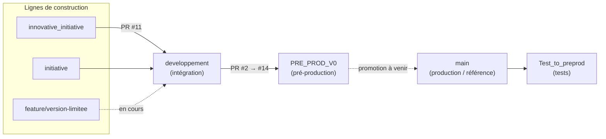
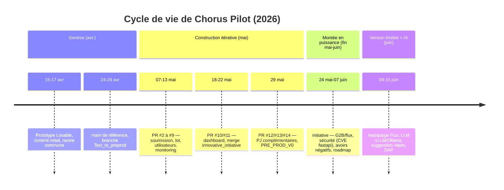

# Dossier d'Architecture Projet (DAP) — Cycle de vie du produit

**Projet : Chorus Pilot** (hub d'automatisation de facturation — InvoicePilot)

| | |
|---|---|
| **Projet** | Chorus Pilot — factures Chorus Pro via PISTE |
| **Dépôt** | `JADIAhmedAmine/chorus-path-finder-main` (privé) |
| **Périmètre du document** | Cycle de vie du produit, modèle de branches et chronologie d'intégration |
| **Version du document** | 1.0 |
| **Date** | 15 juin 2026 |
| **Statut** | Diffusable (interne projet) |
| **Auteur** | Équipe Gigalis |
| **Document compagnon** | [DAP technique](DAP-chorus-pilot.md) (architecture) |

> Document interne — ne pas diffuser hors du périmètre projet.

---

## Historique des révisions

| Version | Date | Auteur | Modifications |
|---|---|---|---|
| 1.0 | 15/06/2026 | Équipe Gigalis | Création : analyse des 7 branches Git, reconstitution du cycle de vie, modèle de promotion, chronologie d'intégration (PR #2→#14), état courant et trajectoire. |

> Données issues de l'analyse du dépôt Git au 15/06/2026 (80 commits, 7 branches, premier commit le 15/04/2026). Pour l'architecture technique détaillée, voir le [DAP technique](DAP-chorus-pilot.md).

---

## 1. Objet et méthode

Ce document **raconte le cycle de vie de Chorus Pilot** à travers l'analyse de son dépôt Git : genèse, phases de construction, modèle de branches, gouvernance d'intégration (*pull requests*), passage de la qualification vers la pré-production, état courant et trajectoire à venir.

La reconstitution s'appuie sur des faits vérifiables : topologie des commits (`git log --graph`), divergence des branches (`merge-base`, *ahead/behind*), empreinte de chaque branche (zones de code modifiées), chronologie des *merges* de PR, et la roadmap produit ([roadmap.md](../roadmap.md)).

**Vue d'ensemble chiffrée :** 80 commits · 7 branches · ~2 mois d'activité (15/04 → 15/06/2026) · 13 *pull requests* d'intégration · racine commune `30f4eda` (17/04/2026).

---

## 2. Genèse et vision

Le produit naît mi-avril 2026 d'un **prototype d'interface** généré avec **Lovable** (l'empreinte subsiste : `package.json` nommé `vite_react_shadcn_ts`, dépendance `lovable-tagger`). Le **commit initial** (`3106e20`, *« Initial clean commit »*) date du **15/04/2026** ; la **racine commune** de toutes les lignes de développement actives est `30f4eda` (*« Progress »*, **17/04/2026**).

Très tôt, le projet dépasse le prototype d'écran pour devenir une **application full-stack** : ajout du backend FastAPI, de l'intégration Chorus/PISTE, de la base PostgreSQL et de la conteneurisation. La vision se fixe (cf. [docs/architecture.md](architecture.md)) : un **hub d'automatisation de facturation** (*InvoicePilot*) dont Chorus Pro n'est que le premier connecteur — et non une PDP.

---

## 3. Modèle de branches et de promotion

Le projet suit un **flux d'intégration par *pull requests*** avec promotion progressive de la maturité, du développement vers la production.

| Branche | Rôle dans le cycle de vie | Statut |
|---|---|---|
| `main` | Mainline / référence de production. Baseline initiale, sert de point de comparaison. | Stable, **en retard** sur le travail récent (cf. §8). |
| `Test_to_preprod` | Branche de **tests** dérivée de `main`, courte durée de vie. | Historique (figée fin avril). |
| `developpement` | Branche d'**intégration** : reçoit le travail des lignes de construction, source des PR. | Active (jusqu'à fin mai). |
| `innovative_initiative` | **Première ligne** de construction fonctionnelle. | Intégrée (PR #11). |
| `PRE_PROD_V0` | **Candidat de pré-production V0**, consolidé depuis `developpement` via PR. | Pré-prod (figé fin mai). |
| `initiative` | **Montée en puissance** : plus large expansion fonctionnelle (G2B, flux, tests). | Active (jusqu'au 07/06). |
| `feature/version-limitee` | **Livraison courante** : version limitée + IA + documentation. | **Tête courante** (15/06). |

**Empreinte par branche** (nombre de fichiers modifiés vs `main`, par zone) — révèle l'ampleur croissante :

| Branche | `src` | `chorus_python` | `tests` | `alembic` | Lecture |
|---|---|---|---|---|---|
| `innovative_initiative` | 104 | 21 | 4 | 5 | Première vague (front + intégration Chorus). |
| `PRE_PROD_V0` | 104 | 21 | 7 | 5 | Consolidation de la 1ʳᵉ vague. |
| `developpement` | 124 | 25 | 14 | 5 | Intégration continue, renforcement des tests. |
| `initiative` | 165 | 43 | 24 | 9 | Expansion majeure (G2B/flux, schéma, tests). |
| `feature/version-limitee` | 170 | 43 | 24 | 10 | Surcouche version limitée + IA + docs. |

---

## 4. Chronologie du cycle de vie

### Phase 0 — Genèse et socle (15–29 avril 2026)

Prototype d'interface, puis bascule en application full-stack. Établissement de `main` comme référence (10 commits, jusqu'au 24/04) et d'une première branche de **tests** `Test_to_preprod` (dérivée de `main`, 13 commits, jusqu'au 29/04). Premiers correctifs de soumission, configuration des ports, ajustements esthétiques. **Premier module métier documenté** : extraction PDF (`chorus_python/extraction.py`, 23 motifs de nettoyage — cf. [CHANGES.md](../CHANGES.md)).

### Phase 1 — Construction itérative par PR (7–29 mai 2026)

Le cœur fonctionnel se construit sur `developpement` et se promeut par **13 *pull requests*** (#2 → #14), chacune jalonnant une capacité :

| PR | Date | Apport |
|---|---|---|
| #2 | 07/05 | Correction du format de soumission |
| #3 | 07/05 | Licence |
| #4 | 11/05 | Mise à jour de version |
| #5 | 12/05 | Affinage **soumission par lot** |
| #6 | 12/05 | **Monitoring** + gestion des codes d'accès |
| #7 | 12/05 | Gestion des **utilisateurs** |
| #8 | 12/05 | Reconnaissance de l'**entité de soumission** |
| #9 | 13/05 | Soumission par lot (montée en charge) |
| #10 | 18/05 | **Tableau de bord** (année courante par défaut) |
| #11 | 22/05 | Intégration de `innovative_initiative` |
| #12 | 29/05 | **Pièces jointes complémentaires** |
| #13 / #14 | 29/05 | Consolidation `developpement` → `PRE_PROD_V0` |

À l'issue de cette phase : émission/soumission (unitaire et par lot), gestion des utilisateurs et des accès, monitoring et tableau de bord — le **MVP émission** est en place.

### Phase 2 — Pré-production V0 (29 mai 2026)

`PRE_PROD_V0` consolide `developpement` (PR #13) : **premier candidat de pré-production**. La stack de déploiement (Docker Compose prod, migrations automatiques, CI/CD) est opérationnelle.

### Phase 3 — Montée en puissance fonctionnelle (24 mai – 7 juin 2026)

La ligne `initiative` porte l'**expansion la plus large** (165 fichiers `src`, 43 `chorus_python`, 24 `tests`, 9 migrations) : socle **Flux / G2B**, génération UBL, enrichissement réception, élargissement des tests et du schéma. Cette phase intègre aussi des **marqueurs de maturité** :

- **sécurité de la chaîne d'approvisionnement** : exclusion explicite d'une version compromise de FastAPI (`Exclude fastapi 0.136.3 (MAL-2026-4750)`) ;
- **fidélité aux données réelles** : autorisation des **montants négatifs** (avoirs/rejets) + réparation du *merge* Alembic ;
- **formalisation de la roadmap produit** ([roadmap.md](../roadmap.md), généré le 07/06).

### Phase 4 — Version limitée et assistance IA (9–15 juin 2026, *en cours*)

`feature/version-limitee` (dérivée d'`initiative`) constitue la **livraison courante** :

- **masquage réversible** du socle Flux (drapeau `FLUX_ENABLED`, backend intact) ;
- **assistance LLM** branchée sur l'extraction (vLLM/Ollama) ;
- **suggestion de traitement des rejets** (rejet / recyclage / suspension) ;
- **paramétrage des ports hôtes** Docker (isolation multi-instances) ;
- correctif Alembic ; **documentation d'architecture** (DAP technique + ce DAP cycle de vie).

C'est la branche la plus avancée (77 commits d'avance sur `main`) et la seule à adopter pleinement les **commits conventionnels** (`feat:`, `fix:`, `chore:`, `docs:`) — signe de maturation du processus.

---

## 5. Environnements et portes de maturité

Le cycle de vie technique s'articule avec les environnements **Chorus/PISTE** :

| Environnement | Cible PISTE | Pilotage |
|---|---|---|
| **Qualification (sandbox)** | `sandbox-*.piste.gouv.fr` | `CHORUS_ENV=qualif` (défaut sécurisé) |
| **Production** | `*.piste.gouv.fr` | `CHORUS_ENV=prod` (activation explicite) |

**Portes de promotion** : *construction* (`initiative`, `feature/*`) → *intégration* (`developpement`) → *tests* (`Test_to_preprod`) → *pré-production* (`PRE_PROD_V0`) → *production* (`main`). Le déploiement de l'environnement de développement est **automatisé** (CI/CD `deploy-development.yml`, déclenché à la réussite de la CI sur `developpement`). La promotion vers la production reste **manuelle** et conditionnée par la validation en qualification (cf. roadmap, *« promotion gate from qualification »*).

**Contraintes transverses respectées à chaque *release*** (cf. roadmap) : secrets côté serveur uniquement, pas de journalisation du `cpro-account`, limites de taille des flux (10 Mo / 30 Mo compressé), textes métier rattachés aux sources officielles, re-vérification des spécifications externes.

---

## 6. État courant (15 juin 2026)

- **Branche livrée** : `feature/version-limitee` — version limitée fonctionnelle, déployable, documentée. Périmètre recentré sur le parcours « factures » + assistance IA, socle Flux masqué (réversible).
- **Pré-production** : `PRE_PROD_V0` reflète l'état de fin mai (avant l'expansion `initiative` et la version limitée).
- **Production / `main`** : reste à la baseline du **24/04** — **non synchronisée** avec le travail des deux derniers mois.
- **Déploiement réel** : instances Docker isolées sur serveur (prod + instance de test), ports paramétrables, déploiement par clé SSH dédiée.

---

## 7. Trajectoire à venir (roadmap produit)

La [roadmap.md](../roadmap.md) (07/06/2026) séquence la suite du cycle de vie en phases :

| Phase | But | Contenu clé |
|---|---|---|
| **Phase 0** — Vérifier les fondations | Lever l'incertitude réglementaire/API | Verrouiller les tables endpoints/erreurs (Spéc. Externes), OAuth2 (grant/scopes/TTL), calendrier réforme B2B. |
| **Phase 1** — MVP « prévenir & expliquer » | Déposer moins de rejets, comprendre chaque statut | Durcir la **validation pré-dépôt**, lecture des **CR** en langage clair, guidage par statut, parcours *directory-first*, hub `/flux`, onboarding PISTE. |
| **Phase 2** — Récupérer & passer à l'échelle | Transformer rejets/suspensions en récupération guidée | Correction+resoumission guidée, gestion des suspensions, **historique de dépôts persisté**, dépôt en masse + monitoring G2B, **porte de promotion** qualif→prod. |
| **Phase 3** — Insight & différenciation | Valeur de pilotage | **Analytics** (taux de rejet, motifs, délai de paiement), multi-structure/multi-fournisseur, export conformité/audit, reporting. |
| **Phase 4** — Adjacence stratégique | Anticiper la réforme B2B *(à confirmer)* | Évaluation **PDP/PPF**, intégration annuaire/PPF, couverture de formats (Factur-X/UBL/CII). |

---

## 8. Observations de processus et recommandations

Constats factuels issus de l'analyse, à valeur d'aide à la décision :

1. **Désynchronisation de `main`.** La mainline de production est figée au 24/04, alors que l'essentiel de la valeur (Flux/G2B, IA, version limitée) vit dans `initiative` et `feature/version-limitee`. **Recommandation :** définir et exécuter une **porte de promotion** explicite (`feature/version-limitee` → `PRE_PROD_V1` → `main`) pour aligner la production.
2. **Pré-production datée.** `PRE_PROD_V0` ne reflète pas les phases 3–4. **Recommandation :** produire un `PRE_PROD_V1` à partir de la livraison courante avant toute mise en production.
3. **Hygiène des messages de commit hétérogène.** Les phases initiales comportent des messages peu explicites (`THIS`, `HHH`, `sdcfvgh`) ; la version limitée adopte les **commits conventionnels**. **Recommandation :** généraliser cette convention et **étiqueter les jalons** (tags `vX.Y` — aucun tag n'existe à ce jour).
4. **Multiplicité des lignes de construction.** `innovative_initiative`, `initiative` et `feature/version-limitee` se recouvrent. **Recommandation :** archiver/clore les lignes intégrées pour clarifier l'arbre.
5. **Continuité de la traçabilité.** Le dédoublement événements métier / journaux techniques (cœur InvoicePilot) n'est pas matérialisé en base sur la branche livrée (cf. [DAP technique §7.2/§18](DAP-chorus-pilot.md)). **Recommandation :** réactiver avant exploitation des modules concernés.

---

## 9. Annexes

### 9.1 Synthèse des branches

| Branche | Commits | Période | Avance / `main` | Tête |
|---|---|---|---|---|
| `main` | 10 | 15/04 → 24/04 | — (référence) | `ADD` |
| `Test_to_preprod` | 13 | 15/04 → 29/04 | +3 | `ADD` |
| `developpement` | 63 | 15/04 → 29/05 | +59 | Merge `initiative` |
| `PRE_PROD_V0` | 52 | 15/04 → 29/05 | +48 | Merge PR #13 |
| `innovative_initiative` | 38 | 15/04 → 22/05 | +34 | `UPGRADE` |
| `initiative` | 73 | 15/04 → 07/06 | +69 | ` TH'` |
| `feature/version-limitee` | 81 | 15/04 → 15/06 | +77 | `docs(dap): …` |

*(Toutes les lignes actives partagent la racine commune `30f4eda` du 17/04/2026 ; `Test_to_preprod` diverge plus tard, de `main`, le 24/04.)*

### 9.2 Documents liés

- [DAP technique](DAP-chorus-pilot.md) — architecture détaillée et valorisation.
- [roadmap.md](../roadmap.md) — roadmap produit (phases 0–4).
- [CHANGES.md](../CHANGES.md) — journal de changements (extraction PDF).
- [docs/architecture.md](architecture.md) — vision produit InvoicePilot.
- [README.md](../README.md) — démarrage, déploiement, exploitation.
